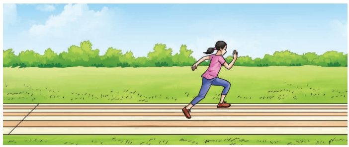
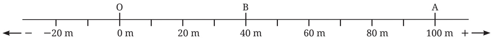
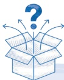
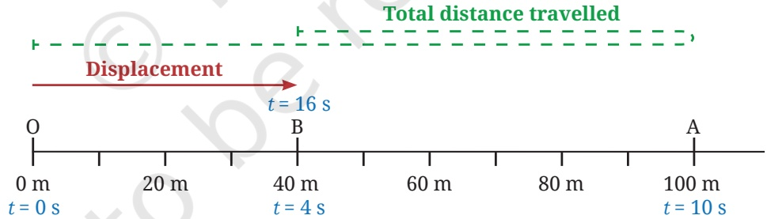

Fig. 4.2: An athlete running on a straight track

Let us take the example of an athlete running on a straight track (Fig. 4.2).

To describe the position of the athlete, let us take her starting point as the reference point. As shown in Fig. 4.3, let us make a straight line with distances marked on it and mark the reference point on it as the **origin** ʻOʼ. The athlete starts running from O, and her positions at two instants of time are marked by points B and A.

Fig. 4.3: Reference point and positions of the athlete at different instants of time on a straight line

## Note

An instant of time and a time interval are not the same thing. An **instant of time** is a single reading of clock at a given point of time. Whereas, a **time interval** is the time duration between two instants of time, i.e., between two readings of a clock.

To describe the position of an object, we also need to specify its direction. For the object moving in a straight line, the object can move only in one of the two directions — forward and backward. Thus, the direction is represented by plus ( ) and minus (–) signs as shown in Fig. 4.3. Positions to the right of the reference point O are generally taken as positive, and to the left of O as negative (Fig. 4.3).

## 4.1.2 Distance travelled and displacement

Suppose an athlete starts running from point O at time t = 0 s, reaches point B at t = 4 s, then reaches point A at t = 10 s, then runs back along the same path till point B reaching there at t = 16 s (Fig. 4.4). How much is the total **distance travelled** by the athlete between the starting and stopping positions? The total distance travelled is OA + AB = 100 m + 60 m = 160 m.

## Ready to Go Beyond

about these in higher grades.

Physical quantities which can be specified by just their numerical value are called scalars. Physical quantities which require specifying both the direction and magnitude are called vectors. You will learn

Fig. 4.4: Reference point and positions of athlete at different instants of time

Let us now think about the distance between the starting and the stopping positions of the athlete. It is OB = 40 m, which is different from the total distance travelled by the athlete. So, let us now define another quantity — displacement.

**Displacement** is the net change in the position of an object between the two given instants of time. A complete description of physical quantities like displacement requires specifying both a direction and its numerical value (with units). The numerical value (with units) of such a physical quantity is called its **magnitude**. The magnitude of displacement is the distance between the object’s positions at the two instants. The direction of displacement is specified from the position at the first instant towards the position at the second instant. To describe the total distance travelled,