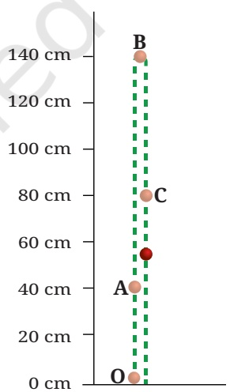
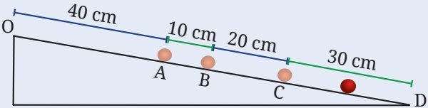

only the numerical value (with units) is required, not the direction of motion. The **SI unit** for both is the **metre (m)**.

For example, in Fig. 4.4, between t = 0 s and t = 16 s, the total distance travelled by the athlete is 160 m, but her displacement is 40 m in the positive direction. We find that between these two instants, the total distance travelled and the magnitude of displacement are not equal. Can these quantities ever be equal?

## Activity 4.1: Let us analyse

1. As shown in Fig. 4.5, a ball is thrown vertically upwards from O. It moves up straight till B and then falls back to O. Can this be considered a motion in a straight line?

2. For this motion, fill up the values in Table 4.1.

Table 4.1: Distance travelled and displacement of the ball

| S. No. | Position | Total distance travelled by the ball from O till that position | Displacement of the ball from O till that position |
| --- | --- | --- | --- |
| 1. | O | 0 cm | 0 cm |
| 2. | A | 40 cm | 40 cm in upward direction |
| 3. | B |  |  |
| 4. | C |  |  |
| 5. | O |  |  |

3. **Analyse** the data filled in Table 4.1 and choose which of the following is true for displacement:

(i) It is never zero.

(ii) Its magnitude can be greater than the total distance travelled.

(iii) Its magnitude is less than or equal to the total distance travelled.

(iv) Its magnitude is less than the total distance travelled in all cases.

## Note

in vertical motion (two separate lines are shown only for clarity; in reality, the object goes up and falls back in the same straight line)

For motion in a straight line, the total distance travelled and the magnitude of displacement are equal if the object moves without turning back, i.e., if it moves in one direction.

Fig. 4.5: A ball

## Pause and Ponder

1. In the example of an athlete running back and forth on a straight track (Fig. 4.4), when will the displacement of the athlete be zero? What will be the total distance travelled in that case?

2. Fuel used up in a vehicle depends on which of the following? Justify your answer.

(i) Total distance travelled

(ii) Displacement

3. A ball rolls down an inclined track as shown in Fig. 4.6. Is its motion, a straight line motion? Assuming the starting point of the ball (O) to be the origin, can its motion from O to D be depicted using a horizontal line as shown in Fig. 4.3? Are the values of total distance travelled and magnitude of displacement from O equal or different at positions A, B, C and D?

Fig. 4.6: A ball rolling down an inclined track