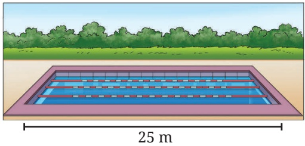

Let us define another physical quantity, average velocity, which describes how fast the position of an object is changing and in which direction.

The **average velocity** of an object in a time interval is the change in the position (or displacement) divided by the time interval in which the change in position (or displacement) occurs. Thus,

$$
average velocity  = \frac{ change in position }{ time interval } = \frac{ displacement }{ time interval }\tag{4.2a}
$$

If we represent average velocity by $\nu _ { _ { a v } }$ , displacement by s and time interval by t, then Eq. (4.2a) can be written as

$$
\nu _ { _ { a \upsilon } } = \frac { S } { t }\tag{4.2b}
$$

**Note**

To express the average velocity, you need to specify its magnitude as well as the direction. How do we associate direction with velocity when the motion is in a straight line? The direction of the velocity is the same as the direction of displacement and is indicated by $a^{*} + \mathrm{or} -$ sign.

The **SI unit of average speed** and **average velocity** are the same. It is **metre per second** which is represented by **m** $\mathbb { S } ^ { - 1 }$ or **m/s**. It is also commonly measured in kilometre per hour (km h–1).

For motion in a straight line, the average speed and the magnitude of average velocity in a time interval are equal if the object moves in one direction.

To describe how fast or slow a change in a physical quantity happens, we use the idea of a rate of change. The ratio of change in one quantity to the corresponding change in time is called the **rate of change**. To calculate average velocity, we find the ratio of change in position to the time taken (Eq. 4.2a). So, we can say that average velocity is the average rate of change of position of an object with respect to time.

**Example 4.2:** Sarang takes 50 seconds to swim from one end to the other end and back in the swimming pool shown in Fig. 4.7. Find his average speed and average velocity within the time interval of 50 s.

**Answer:**

Total distance travelled by Sarang in $50\;s = 50$ m

displacement of Sarang in $50\ \overline{s} \equiv 0$ m

$$
average speed  = \frac{ total distance truelevel }{ time interval } = \frac{50   m }{50   s } = 1   m   s ^{-1}
$$

$$
average velocity  = \frac{ displacement }{ time interval } = \frac{0   m }{50   s } = 0   m   s ^{-1}
$$

Fig. 4.7: Swimming pool

During the 50 s time interval, the average speed of Sarang is approximately 1 m $\mathbb { S } ^ { - 1 }$ while his average velocity is 0 m $\mathbb { S } ^ { - 1 }$

## Pause and Ponder

4. During a family road trip, you drive 200 km north in three hours. Afterwards, you drive 200 km south in two hours. Find the average speed and average velocity for your entire trip.

5. Under what condition(s) is the

(i) magnitude of average velocity of an object equal to its average speed?

(ii) magnitude of average velocity of an object zero while its average speed is not zero?