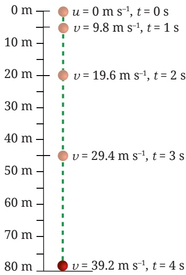

In this chapter, we will consider only the cases where the acceleration is constant.

## Note

The average acceleration during different time intervals can either be constant or changing. For an object moving in a straight line in the same direction, if the magnitude of its velocity increases or decreases by equal amounts in equal intervals of time (for all possible choices of time intervals), the acceleration of the object is constant.

**Example 4.4:** As we learnt earlier, when an object is Grade 8 dropped from a height, it takes a straight vertical path Curiosity Chapter 5 downwards before touching the ground. While coming down, the velocity of the object increases as shown in Fig. 4.10 at different instants. Find the magnitude of the average acceleration of the object in every successive interval of a second. Is the average acceleration constant across all intervals? What is the direction of this average acceleration?

Fig. 4.10: An object dropped from a height

**Answer:** The magnitude of the average acceleration in every successive interval is

average acceleration between 0 s and $\frac{(9.8 - 0)    m     s ^{-1}}{(1 - 0)    s } = 9.8    m     s ^{-2}$ average acceleration between 1 s and $2\  s =\frac{(19.6 - 9.8)\  m \  s ^{-1}}{(2 - 1)\  s }=9.8\  m \  s ^{-2}$ average acceleration between 2 s and $\frac{(29.4 - 19.6)    m     s ^{-1}}{(3 - 2)    s } = 9.8    m     s ^{-2}$ average acceleration between 3 s and $4\  s = \frac{(39.2 - 29.4)\  m \  s ^{-1}}{(4 - 3)\  s } = 9.8\  m \  s ^{-2}$

We note that the average acceleration is constant and equal to 9.8 m ${ \sf S } ^ { - 2 } ,$ . As the velocity is increasing in the direction of motion, the acceleration is in the direction of motion. This acceleration is called the acceleration due to gravitational force by the Earth and is denoted by g.

## Ready to Go Beyond

Similar to ʻvelocity at an instantʼ, ʻacceleration at an instant’ is known as ‘instantaneous acceleration’. You will learn more

Did you notice that in Fig. 4.5, we chose the origin at the ground level while in Fig. 4.10, we chose the origin at the point from where the object is dropped? In this example, we use down side as positive. We can choose the origin and positive direction as per our convenience. However, once chosen, it should not be changed while solving a problem.

Just like we can specify the velocity of an object at an instant, we can specify the acceleration of an object at an instant.

about it in higher grades.

**Next Level Up**

**Grade 8 Ganita Prakash Part II Chapter 5**

## 4.2 Graphical Representation of Motion

One useful way of representing motion can be a graphical representation. It provides a visual representation of how position, velocity, and acceleration change with time. Such graphs help in comparing the motion of two objects, in calculating physical quantities, or in identifying whether the motion is uniform or non-uniform.

As you have learnt in Mathematics, graphs come in various forms, each suited to different types of data representation. To describe motion, we will use graphs to show dependence of one physical quantity, such as position, velocity or acceleration, on another quantity, such as time. Let us learn to plot and interpret line graphs for motion.