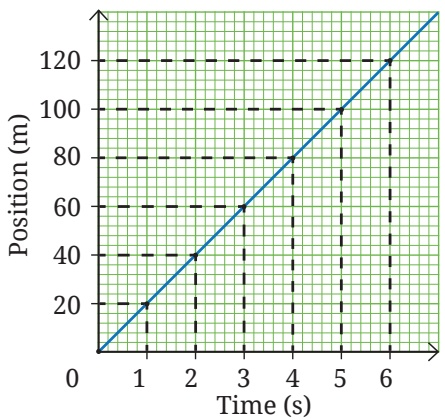
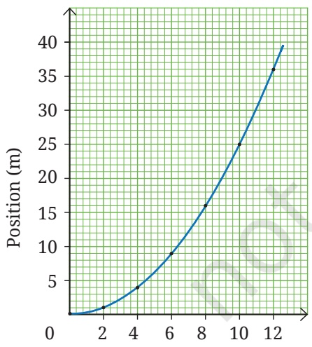

Fig. 4.11(c): Making a graph

this point. Then, draw a line parallel to the X-axis from the point corresponding to distance 20 m on the Y-axis. The point where these two lines intersect represents the position 20 m at time t = 1 s on the graph (Fig. 4.11b).

(iii) Similarly, plot on the graph paper all points corresponding to positions of the vehicle at different instants of time.

7. Once all points are plotted, connect them to create the position-time graph for the vehicle’s motion (Fig. 4.11c). It is a straight line for the data given in Table 4.3.

This was an example of plotting a position-time graph. Similar procedure can be used to plot the other graphs which you will be learning ahead.

## Note

Remember, a graph is not a route map. It does not show the route but how the position of the object changes with time with respect to the origin.

## Ready to Go Beyond

The intermediate points represent possible values for position of vehicle at intermediate times. They are correct if vehicle is moving with a constant speed.

**Example 4.5:** For a vehicle starting from rest and speeding up, the data for position and time are given in Table 4.4. Plot the position-time graph corresponding to it.

Table 4.4: Positions of vehicle at different instants of time

| Time | Position |
| --- | --- |
| 0 s | 0 m |
| 2 s | 1 m |
| 4 s | 4 m |
| 6 s | 9 m |
| 8 s | 16 m |
| 10 s | 25 m |
| 12 s | 36 m |

Fig. 4.12: Position-time graph of the vehicle

## Answer:

Choosing the scale to be

X-axis: 5 divisions = 2 s

Y-axis: 5 divisions = 5 m

and following the procedure of Activity 4.3, all points corresponding to positions of the vehicle at different instants of time are marked. Unlike Fig. 4.11c, the points do not fall on a straight line. The points can be joined by a curve as shown in Fig. 4.12.

Now that you know how to plot a graph from the data given for the motion of an object, let us learn to **interpret** the graphs.