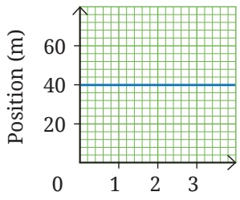
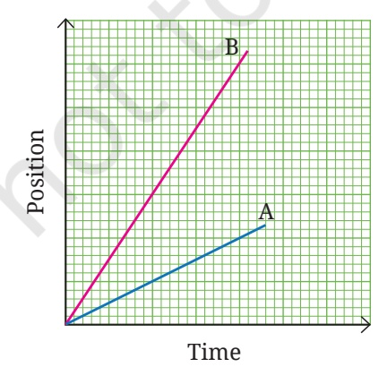
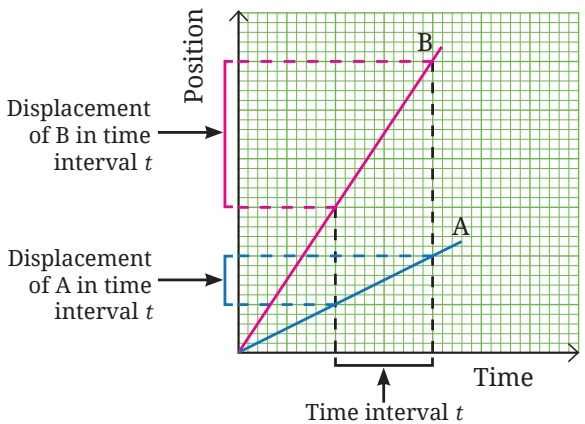

3. As per Eq. (4.2a), by dividing the change in position (BC) by the change in time (CA), you get the average velocity

$$
\nu = \frac{s_{2} - s_{1}}{t_{2} - t_{1}} = \frac{\overline{BC}}{CA}
$$

4. By extracting values of time $t _ { 1 }$ and $t _ { 2 } ,$ and distances $S _ { 1 }$ and $S _ { 2 }$ from the graph, the magnitude of average velocity can be calculated as

$$
v=\frac{80\  m -40\  m }{4\  s -2\  s }=\frac{40\  m }{2\  s }=20\  m \  s ^{-1}
$$

From a position-time graph, by finding the positions of the object at two instants of time, you can calculate the average velocity by using Eq. (4.2a).

Geometrically, $\frac { \mathrm { B C } } { \mathrm { C A } }$ is called the slope of line AB connecting initial

position A and final position B in Fig. 4.14. The slope of a line is the steepness of the line. The slope of a graph gives information about the rate of change of the quantity shown on Y-axis with respect to the quantity shown on X-axis.

## Ready to Go Beyond

For the case of a curve also, the velocity at any instant can be calculated geometrically from the position-time graph. You will learn how to do it in higher grades.

**Example 4.6:** What does the graph shown in Fig. 4.15 indicate about the nature of motion of the vehicle?

**Answer:** The position of the vehicle is 40 m from the origin and is not changing with time. Thus, the vehicle is at rest at 40 m from the origin. A straight line parallel to the time axis on a position-time graph represents a stationary object (In this case, the position-time graph is not the distance-time graph).

Fig. 4.15: Position-time graph of a vehicle

**Example 4.7:** The position-time graphs of two objects A and B are given in Fig. 4.16a. The magnitude of average velocity of which object is higher? **Answer:** By making lines parallel to axes as shown in Fig. 4.16b, it is found that the displacement of object B is more than object A for the same time interval. That is, the slope of line for B is steeper than the slope for line A. Thus, the velocity of B is higher than that of A.

Fig. 4.16(a): Position-time graph of two objects

Fig. 4.16(b): Comparing displacement of two objects from position-time graph