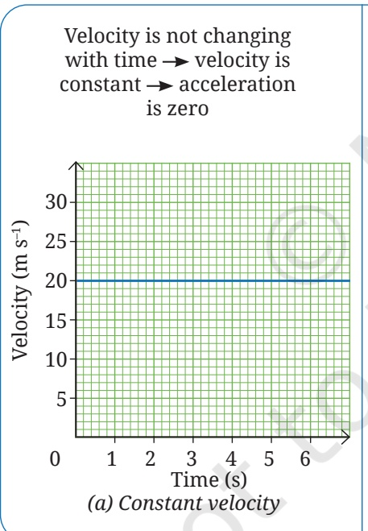
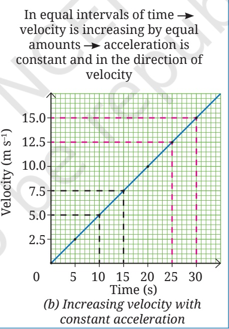
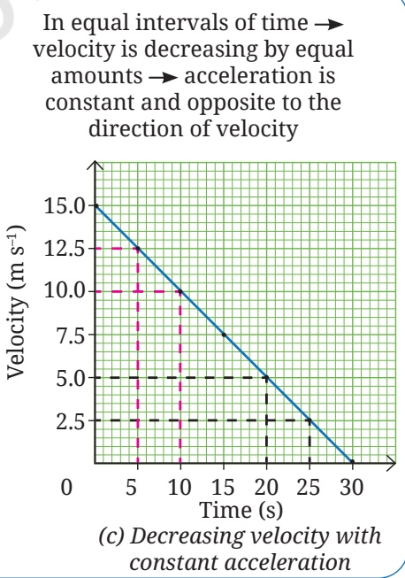

## 4.2.3 Velocity-time graphs

The velocity-time graph of an object in motion represents the change in its velocity with time. In a manner similar to the position-time graph, you can plot velocity-time graphs following the steps of Activity 4.3.

Let us take the example of a car moving in the same direction on a straight stretch of a highway at a steady velocity of 72 km $\mathrm { h } ^ { - 1 }$ or $2 0 \; \mathrm { { m } \; s ^ { - 1 } }$ The velocity-time graph corresponding to it is shown in Fig. 4.17a.

Consider another car that starts moving from rest and its velocity increases with time as shown in Table 4.5. The velocity-time graph plotted for this case is shown in Fig. 4.17b.

Consider yet another car moving with a velocity of 15.0 m $\mathbb { S } ^ { - 1 }$ . Its velocity decreases with time as shown in Table 4.6 and its velocity-time graph is shown in Fig. 4.17c.

Table 4.5: Increasing velocity

Table 4.6: Decreasing velocity

<table><tbody><tr><td rowspan="2">Time</td><td rowspan="2">Velocity of car</td></tr><tr></tr><tr><td>0 s</td><td>0 m s-1</td></tr><tr><td>5 s</td><td>2.5 m s-1</td></tr><tr><td>10 s</td><td>5.0 m s-1</td></tr><tr><td>15 s</td><td>7.5 m s-1</td></tr><tr><td>20 s</td><td>10.0 m s-1</td></tr><tr><td>25 s</td><td>12.5 m s-1</td></tr><tr><td rowspan="2">30 s</td><td rowspan="2">15.0 m s-1</td></tr><tr></tr></tbody></table>

| Time | Velocity of car |
| --- | --- |
| 0 s | 15.0 m s-1 |
| 5 s | 12.5 m s-1 |
| 10 s | 10.0 m s-1 |
| 15 s | 7.5 m s-1 |
| 20 s | 5.0 m s-1 |
| 25 s | 2.5 m s-1 |
| 30 s | 0 m s-1 |

## What does the shape of the velocity-time graph indicate about the nature of motion?

Fig. 4.17: Velocity-time graph of a moving car

When the velocity of the car is constant, the velocity-time graph is a straight line parallel to the X-axis (Fig. 4.17a) and acceleration is zero. A straight line velocity-time graph as shown in Fig. 4.17b indicates that the velocity is increasing with a constant acceleration (in the direction of velocity). Whereas, a straight line velocity-time graph as shown in Fig. 4.17c indicates that the velocity is decreasing with a constant acceleration (opposite to the direction of velocity).