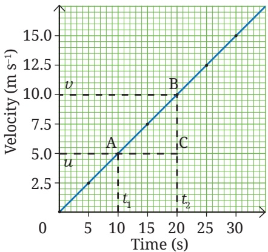
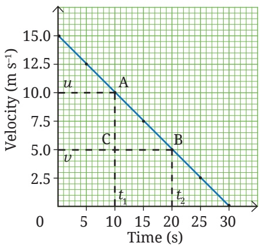
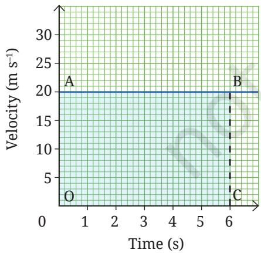

## Which physical quantities can be obtained from a velocity-time graph?

Fig. 4.17(d): Calculating acceleration from a velocity-time graph

Fig. 4.17(e): Calculating acceleration from a velocity-time graph

Apart from finding the magnitude of velocity of the object at each instant of time, what other physical quantities can be calculated from the velocity-time graph?

## Slope of the straight line on graph

In Section 4.2.2, we found that velocity can be determined from the slope of the straight line on position-time graph. What can you find from the slope of the straight line on a velocity-time graph? The slope of the line on velocity-time graph gives how fast the velocity is changing with time, i.e., the acceleration.

For the graph shown in Fig. 4.17a, there is no change in the height of the line from the X-axis, i.e., its slope is zero. Hence, the velocity is constant and the acceleration is zero in this case.

Now consider the graph shown in Fig. 4.17d which is the same as Fig. 4.17b, except for some markings. Consider a part of the line, AB. Suppose at time $t _ { 1 }$ corresponding to point A, the velocity is denoted by ${ } ^ { \circ } u ^ { \flat } ;$ , and at time $t _ { 2 }$ corresponding to point B, it is represented by ${ } ^ { \circ } \nu ^ { \flat } .$ By dividing the change in velocity (BC)

by the change in time (CA), you get, $a \geq \frac{v - u}{t_{2} - t_{1}} = \frac{BC}{CA}$

Substituting the values from graph, we obtain the magnitude of average acceleration between the time interval from 10 s to 20 s

$$
a = \frac{10    ms ^{-1} - 5    ms ^{-1}}{20    s  - 10    s } = \frac{5    ms ^{-1}}{10    s } = 0.5    ms ^{-2}
$$

If we follow the above steps for the graph shown in Fig. 4.17e which is same as Fig. 4.17c, we obtain average acceleration to $\mathrm{be} \sim 0.5   \mathrm{m}   \mathrm{s}^{-2}$ . The minus sign indicates that the direction of acceleration is opposite to the direction of velocity (as the velocity is decreasing).

Can you calculate some other physical quantity from the velocity-time graph?

4.18(a): Velocity-time graph of an object moving with constant velocity

## Area enclosed by the line on graph and time axis

The graphs shown in Fig. 4.18 are same as Fig. 4.17, except that some parts between the line on graph and the time axis are shaded. Does the area of the shaded part represent some physical quantity?

In Fig. 4.18a, OA is magnitude of the velocity and OC is the time interval.

So, area of rectangle OABC = OA × OC = velocity × time interval (Since, in this case the velocity is constant, it is equal to the average velocity).

Using Eq. (4.2a), we can say,

area of rectangle OABC = displacement

Substituting the values from graph, we obtain

displacement between 0 s and 6 s = area of OABC = 20 m s–1 × 6 s = 120 m