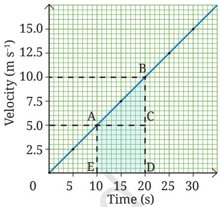
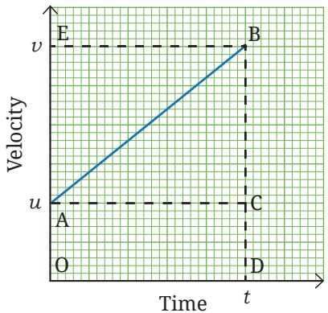

This is the displacement of the car from the origin in 6 seconds. You have found that the area enclosed by the velocity-time graph and the time axis for a desired time interval is equal to the displacement in that time interval.

How can you determine the displacement from the graph given in

Fig. 4.18b? Suppose you want to find the displacement between 10 s to 20 s, corresponding to which the graph points are A and B. We calculate the area between AB and the time axis to obtain the displacement of the object which is moving with a constant acceleration. Thus,

displacement between 10 s to 20 s = area of ABDE

= area of the rectangle ACDE + area of the triangle ABC

$$
\left( \mathrm{CD} \times \mathrm{DE} \right) + \left( \frac{1}{2} \times \mathrm{CA} \times \mathrm{BC} \right)
$$

Substituting the values, we obtain

$$
\mathrm{displacement}=(5\mathrm{~m}\mathrm{~s}^{-1}\times10\mathrm{~s})+\left(\frac{1}{2}\times10\mathrm{~s}\times5\mathrm{~m}\mathrm{~s}^{-1}\right)
$$

Fig. 4.18(b): Velocity-time graph of an object moving with changing velocity with constant acceleration

This is the displacement of the car between 10 s and 20 s.

We learnt that by finding the slope and area from velocity-time graph for motion with constant acceleration, we can determine acceleration and displacement, respectively.

You learnt how to represent motion by graphs. Let us now learn about the equations which describe the motion of an object.

## 4.3 Kinematic Equations for Motion in a Straight Line with Constant Acceleration

Let us consider the special case of motion with constant acceleration and try to derive some equations for analysing such motions. Since the acceleration is constant, acceleration at each instant will be equal to the average acceleration over any time interval.

Using the definition of average acceleration given by Eq. (4.3c),

$$
a = \frac{v - u}{t}
$$

where u is initial velocity at $t = 0    s ,$ v is final velocity at time t, time interval is $t - 0 = t ,$ over which the change in velocity occurs and a is the acceleration, we can write

$$
a t = \nu - u
$$

$$
\nu = u + a t\tag{4.4a}
$$

This equation allows us to calculate velocity (v) at all times if initial velocity (u) and acceleration (a) are known.

The velocity-time graph of Eq. (4.4a) is as shown in Fig. 4.19. This is similar to the graph shown in Fig. 4.18 but now the initial velocity of the object is not zero. The initial velocity (represented by AO) is u and the final velocity at time t (represented by EO) is v. The graph is a straight line indicating that the velocity changes with constant acceleration. The slope of the graph gives the acceleration.

Fig. 4.19: Velocity-time graph where the initial velocity of object is not zero