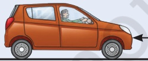
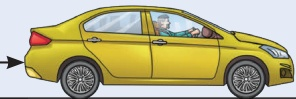

Using these equations, it is possible to predict position or velocity of the object at a future time.

## Note

These kinematic equations are valid only when the acceleration is constant. While using kinematic equations for motion in a straight line in one direction, remember that distance travelled and magnitude of displacement are equal, and speed and magnitude of velocity are also equal. In motion in a straight line in both directions, the sign of $u , v , a ,$ and s in these equations tells us about the direction of that particular quantity.

**Example 4.8:** Suppose a car is moving on a highway and brakes are applied, which cause an acceleration of – 4 m $\overline { { S } } ^ { - 2 }$ . How much will be the distance travelled by the car before coming to a stop, if the car was moving with a velocity of (i) 54 km $\mathrm { h ^ { - 1 } }$ , and (ii) 108 km $\mathrm { h } ^ { - 1 }$ when the brakes were applied?

**Answer:**

Given: a = – 4 m ${ \cal S } ^ { - 2 } ,$ v = 0 m $S ^ { - 1 }$

Suppose the initial velocity is u and the distance travelled is s.

(i) u = 54 km h–1 = 15 m s–1

(ii) $u = 108    km     h ^{-1} = 30    m     s ^{-1}$

Using Eq. (4.4c)

$$
\nu ^ { 2 } = u ^ { 2 } + 2 a s
$$

$$
( 0 \; \mathrm { m } \; \mathrm { s } ^ { - 1 } ) ^ { 2 } = u ^ { 2 } + 2 \times ( - 4 \; \mathrm { m } \; \mathrm { s } ^ { - 2 } ) \times s
$$

$$
0 = u ^ { 2 } - 8 \times s \quad \Rightarrow \quad s = \frac { u ^ { 2 } } { 8 }
$$

Substituting the value of $u _ { \flat }$ we obtain (i) 28.1 m, and (ii) 112.5 m.

## Bridging Science and Society

When brakes are applied to a moving vehicle, it moves some distance before coming to a stop. The distance travelled depends upon the velocity of the vehicle when the brakes are applied, the road surface (wet/dry, etc.), the braking capacity of the vehicle (the negative acceleration caused by the brakes) as well as the driver’s reaction time. Can you now understand why it is important to maintain a safe distance from the vehicle moving ahead of your vehicle (Fig. 4.20) and how this distance needs to be adjusted given your initial velocity?

Fig. 4.20: Safe distance between two moving vehicles

There is a vehicle-to-vehicle (V2V) communication technology, now being developed in many countries including India, which allows vehicles to exchange signals and warns drivers of possible collisions.

Till now, in this chapter, we have been discussing about motion in a straight line which is also called motion in one dimension. Let us now explore motion in a plane.