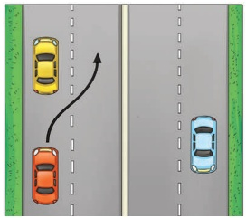
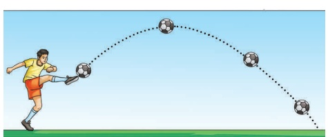
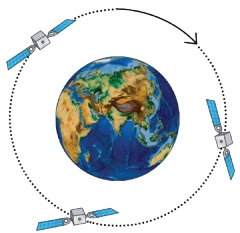
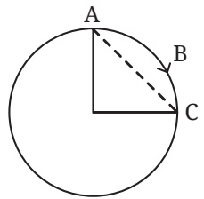
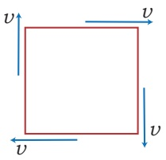
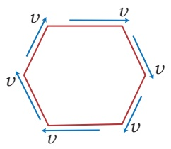
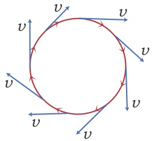

## 4.4 Motion in a Plane

Motion in a plane, such as a vehicle overtaking another, the path of a kicked ball or a satellite moving in a circular path, is called motion in two dimensions (Fig. 4.21).

Fig. 4.21: Motion in a plane

## 4.4.1 Uniform circular motion

**Grade 6** Curiosity **Chapter 5**

Do you remember learning about circular motion in an earlier grade? When an object moves in a circular path, its motion is called circular motion.

Fig. 4.22: Top view of merry-go-round in circular motion

Suppose a child is sitting on a moving merry-go-around. The child, moving on a circular path, moves from A to B to C as shown in Fig. 4.22. What is the distance travelled by the child? What is their displacement from their original position? The distance travelled by the child is the curve ABC and displacement is the straight-line AC. As you can see both are not equal.

What is the distance travelled by the child in making one revolution (going round the circle once)? It is equal to the circumference of the circle. So, if the radius of the circular path is R, the distance travelled by the child in making one revolution is 2 R. On the other hand, the displacement is zero, since the child comes back to its original position after making one revolution.

If an object takes time T to make one revolution, its average speed $\nu _ { a v }$ will be (using Eq. 4.1)

$$
\nu _ { _ { a \upsilon } } = \frac { 2 \pi R } { T }\tag{4.5}
$$

while the average velocity during the time interval T will be 0, since the displacement is 0.

## Note

We calculated the average speed (Eq. 4.5) for one revolution but for uniform circular motion since the speed is constant, its value is the same at every point on the circle.

Let us now consider a particular case of circular motion where the speed of the object is constant. When an object moves in a circular path with constant (uniform) speed, its motion is called **uniform circular motion.**

In case of uniform circular motion, the speed is constant but what about the direction of velocity at an instant? Is it changing?

(a)

(b)

(c)

Fig. 4.23: An athlete running along (a) a rectangular track, (b) a hexagonal track, and (c) a circular track