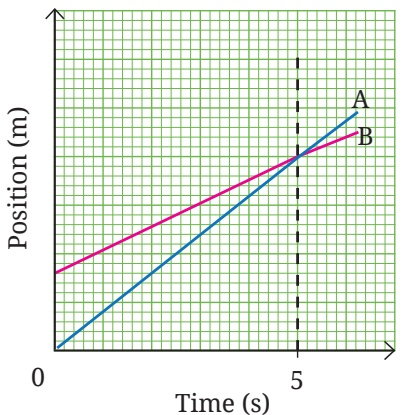
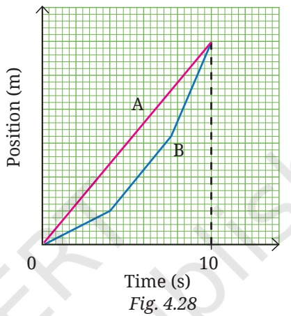
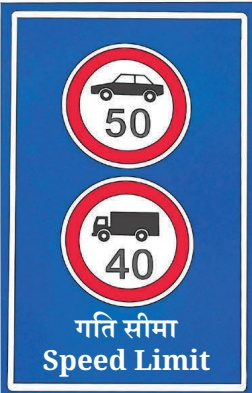

3. A girl is riding her scooter and finds that its speedometer reading is constant. Is it possible for her scooter to be accelerating and if so, how?

4. A car starts from rest and its velocity reaches $2 4 \; \mathrm { m \; s ^ { - 1 } }$ in 6 s. Find the average acceleration and the distance travelled in these 6 s.

5. A motorbike moving with initial velocity 28 m $S ^ { - 1 }$ and constant acceleration stops after travelling 98 m. Find the acceleration of the motorbike and the time taken to come to a stop.

6. Fig. 4.27 shows a position-time graph of two objects A and B that are moving along the parallel tracks in the same direction. Do objects A and B ever have equal velocity? Justify your answer.

Fig. 4.27

7. A graph in Fig. 4.28 shows the change in position with time for two objects A and B moving in a straight line from 0 to 10 seconds. Choose the correct option(s).

(i) The average velocity of both over the 10 s time interval is equal since they have the same initial and final positions.

(ii) The average speeds of both over the 10 s time interval are equal since both cover equal distance in equal time.

(iii) The average speed of A over the 10 s time interval is lower than that of B since it covers a shorter distance than B in 10 seconds.

(iv) The average speed of A over the 10 s time interval is greater than that of B since B’s speed is lower than A’s in some segments.

8. A truck driver driving at the speed of 54 km $\mathrm { h } ^ { - 1 }$ notices a road sign with a speed limit of 40 km $\mathrm { h } ^ { - 1 }$ (Fig. 4.29) for trucks. He slows down to 36 km $\mathrm { h } ^ { - 1 }$ in 36 s. What was the distance travelled by him during this time? Assume the acceleration to be constant while slowing down.

Fig. 4.29

9. A car starts from rest and accelerates uniformly to 20 m $\mathbb { S } ^ { - 1 }$ in 5 seconds. It then travels at 20 m $\mathbb { S } ^ { - 1 }$ for 10 seconds and finally applies the brake (with uniform acceleration) to stop in 6 seconds. Find the total distance travelled.

10. A bus is travelling at 36 km $\mathrm { h } ^ { - 1 }$ when the driver sees an obstacle 30 m ahead. The driver takes 0.5 seconds to react before pressing the brake. Once the brake is applied, the velocity of the bus reduces with constant acceleration of 2.5 m $\mathbb { S } ^ { - 2 }$ . Will the bus be able to stop before reaching the obstacle?