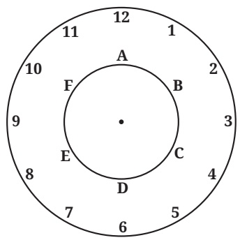
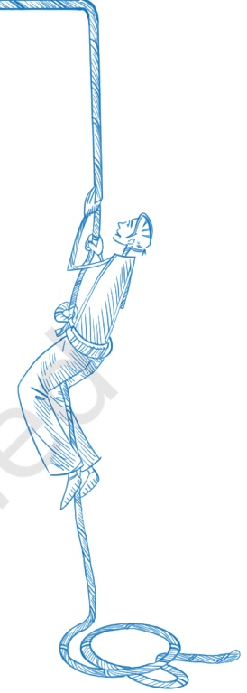

## The Journey Beyond

y Take a cardboard disc (radius \~ 8 cm) (Fig. 4.33). Write numbers 1 to 12 on the outer part (7 cm from the centre) and the letters ‘ABCDEF’ on the inner part (4 cm from the centre), using the same font size. Spin the disc slowly, then faster, and observe how the numbers and letters appear. Why do the numbers fade or disappear while the letters remain visible? Are the speeds of the numbers and letters the same or different? Justify your answer.

Fig. 4.33

Many smartphones have an inbuilt accelerometer that can detect very small accelerations. Install an app, such as Phyphox (phyphox.org) and open ‘Accelerometer (without $g ^ { \flat }$ . Note the readings when (i) the phone is on an outstretched palm, and (ii) the phone is kept on the floor. What differences do you observe? What does this tell you about motion and acceleration in real situations? (Such tiny, involuntary movements are also studied in medical research, for example, in movement disorders) This activity is recommended to be performed as a classroom group activity facilitated by teacher.

For motion in a straight line with constant acceleration, we derived two primary equations given by Eq. (4.4a) and (4.4b). Using these two equations, three more equations can be derived, out of which we derived one given in Eq. (4.4c). Derive the remaining two equations given below

$$
s = vt = \frac{1}{2}at^{2}
$$

$$
s = { \frac { 1 } { 2 } } \left( u   +   \nu \right)   t
$$

V **Grade 8 Ganita Prakash Part II Chapter 7**

In mathematics, you have learnt the formula for calculating the area of a trapezium. Using that formula, derive the second equation given above.

y Plot graphs for data given in Table 4.4, using different X and Y scales, on different graph papers. Compare the graphs to find how the appearance of graph is affected by the choice of scales and decide which scale is better and why. Now repeat this with any graph plotting app. Such apps generally automatically adjust the axes to fit the data well on the screen.

Talk to a motor mechanic about how a vehicle’s braking or stopping distance is affected by: (i) wet roads, (ii) worn-out tyres, (iii) higher vehicle mass, (iv) driving at night, (v) fog, (vi) severe weather (rain, snow, storm), and (vii) driver reaction time. Using this information, design safety posters for your school and prepare a short skit to present it in the assembly.