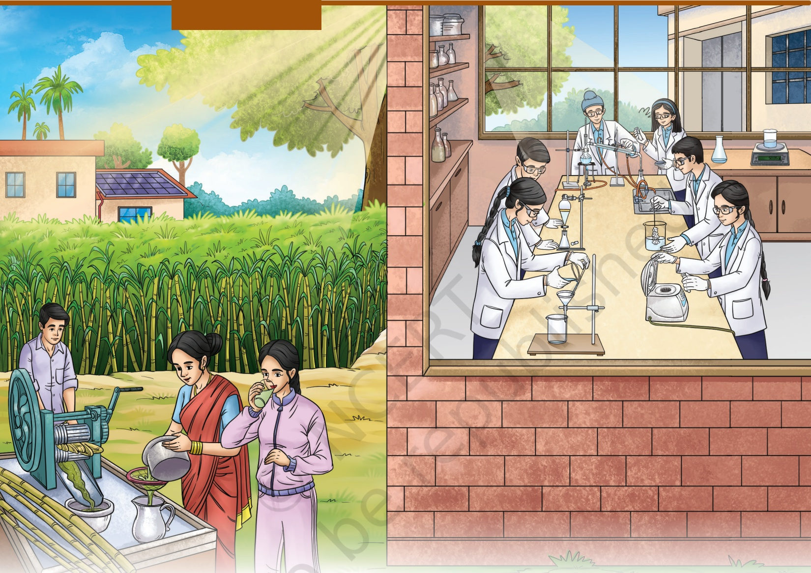
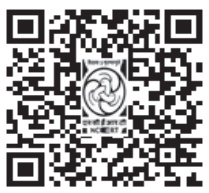
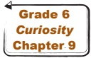

## Exploring Mixtures and their Separation

0906CH05

**Chapter** 5

## Think It Over

Why do suspended particles settle in muddy water over time but not in milk?

How is evaporation different from boiling?

Why do you see bright rays of sunlight when it passes through small gaps between the leaves of a dense tree?

Have you ever wondered how sweet, white crystals of sugar are obtained from tall, green sugarcane plants? Or how do doctors detect diseases like malaria using just a few drops of blood? Many such everyday activities are made possible by techniques based on the fascinating science of separating mixtures.

Grade 6 You have learnt about mixtures and some simple CuriosityChapter 9 methods to separate them. In this chapter, you will **explore** mixtures in greater depth, including their properties, behaviour and the various techniques used to separate them. From industrial processes like sugar production to life-saving medical tests, the separation of mixtures plays a crucial role in our daily lives.