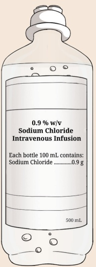

A saline drip in hospitals is usually 0.9 % m/v

sodium chloride (common salt) in water. That means 0.9 g of salt in 100 mL of solution (Fig. 5.5). 0.9% saline solution is safe for blood and replaces lost fluids in the body.

Fig. 5.5: Saline solution

This method is used when two miscible liquids are mixed, for example, in perfumes, cosmetics and vinegar (Fig. 5.4c). The volume by volume percentage (% v/v) tells us how many millilitres of the solute is present in 100 millilitres of the solution. Mathematically,

$$
\text { Volume by volume percentage }=\frac{\text { Volume of solute }}{\text { Volume of solution }} \times 100\tag{5.3}
$$

**Example 5.3:** If 1 mL of a liquid pesticide is mixed with a sufficient amount of water to form 100 mL of a pesticide spray for rice crop, calculate its volume by volume percentage.

**Answer:** Volume of pesticide (solute) = 1 mL

Total volume of solution = 100 mL

$$
\begin{aligned} Volume by volume   &  per centage  \\& = \frac{ Volume of solute }{ Volume of solution } \times 100 \\& = \frac{1  mL }{100  mL } \times 100 = 1\% v/v\end{aligned}
$$

## Note

Commonly used unit in industries is weight by weight percentage (% w/w), as weight and mass are generally used interchangeably. Numerically, both % m/m and % w/w are equal to each other.

## Pause and Ponder

1. A common talcum powder contains 4 % m/m zinc oxide, which acts as an antiseptic. How much zinc oxide is present in 300 g of the talcum powder?

2. Your mother gives you a bottle of orange juice concentrate to mix with water and serve it to your visiting friends. She asks you to mix two tablespoons of the concentrate with water in a glass tumbler. If each tablespoon measures 15 mL and you make 150 mL of juice per person, what is the % v/v of orange juice concentrate in the mixture you prepared?

3. Vinegar, used as a food preservative and additive, contains 5 % v/v acetic acid. Glacial acetic acid is a liquid, i.e., 100% acetic acid. If you want to make vinegar from glacial acetic acid, how would you proceed?

## 5.2.3 Solubility of substances

## Grade 8 Curiosity Chapter 9

You have learnt that the maximum amount of solute that dissolves in a fixed quantity of the solvent (100 mL or 100 g) is called its **solubility** at a given temperature. A solution that cannot dissolve any more solute at that temperature is called a **saturated** solution. Why do we mention the temperature? This is because the solubility of a solid solute in a liquid solvent generally increases with temperature. On the other hand, in the case of gases dissolved in liquids, their solubility generally decreases with an increase in temperature. Solubility is an important property used to separate substances from mixtures. Let us explore it further!