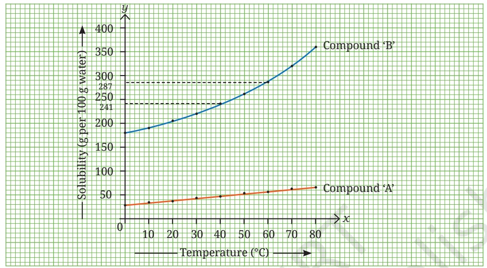

## Activity 5.2: Let us represent solubility graphically

Consider water as the solvent, and compounds ‘A’ and ‘B’ as the solutes. Each substance has a different solubility. A graph of solubility versus temperature is called a **solubility curve**. The solubility curves for ‘A’ and ‘B’ as solutes are shown in Fig. 5.6. The x-axis shows temperature (°C), whereas the y-axis indicates the solubility of the solute in grams per 100 g of water.

Fig. 5.6: Solubility curves of compounds ‘A’ and ‘B’ in water

Based on the information from the above graph, predict which of the two compounds, ‘A’ or ‘B’, will dissolve more in a given amount of water at a given temperature?

Observe Fig. 5.6 and fill in the blanks of the following statements:

(i) The solubility of compound ‘A’ in water at 20 °C is (less than/more than/similar to) its solubility at 60 °C.

(ii) The solubility of compound ‘B’ at 20 °C is (less than/ more than/similar to) its solubility at 60 °C.

(iii) The solubility of \_\_\_\_\_\_ increases more than that of \_\_\_ with an increase in the temperature.

What do you think will happen if you make a saturated solution at a higher temperature and cool it slowly? Let us find out!

## 5.3 Methods of Separation of Homogeneous Mixtures

## 5.3.1 Crystallization

You have learnt to prepare a saturated solution. If you take a saturated solution of compound ‘B’ in water at $6 0 ~ ^ { \circ } \mathrm { C } ,$ prepared by dissolving 287 g of compound ‘B’ in 100 g of water, what will happen if you gradually cool it to 40 °C? As per Fig. 5.6, the solubility of compound ‘B’ is 241 g per 100 g of water at $4 0 ~ ^ { \circ } \mathrm { C } .$ It implies that only 241 g of compound ‘B’ can remain in the solution and the rest of it will separate out as a pure solid, often as crystals. A **crystal** is a solid that is made up of particles arranged in a regular geometric pattern.

4 **Grade 8 Curiosity Chapter 9**