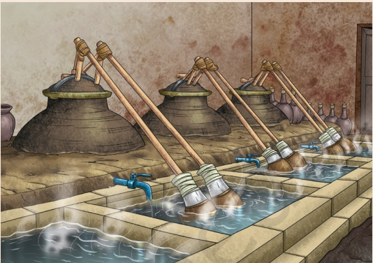
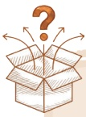
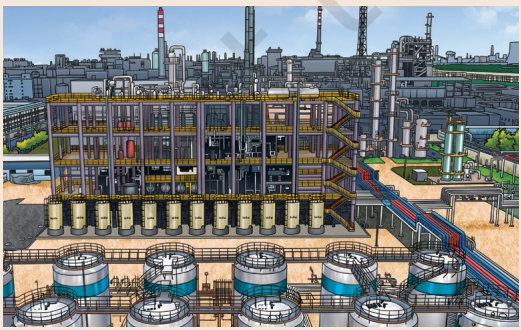
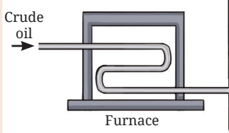
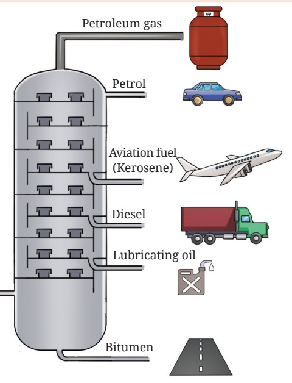

A mixture of acetone and water can be separated by distillation because their boiling points differ sufficiently. Acetone boils at about $5 6 \; ^ { \circ } \mathrm { C }$ and water boils at $1 0 0 \; ^ { \circ } \mathsf { C } .$ A large difference in boiling points allows one liquid to vaporise before the vapours of the other liquid are formed in significant amount.

## India’s Scientific Contributions

The process of distillation has been used for a long time for various purposes, including extraction of fragrances from flowers to make perfumes.

You must have noticed the pleasant earthy smell that rises from the ground after the first rain. In Kannauj, a town in Uttar Pradesh known as the perfume capital of India, this beautiful fragrance is captured and turned into a natural perfume called Mitti ka Ittar (earthy fragrance). This perfume is made using a traditional distillation method known as the Deg-Bhapka method (Fig. 5.13), which has been passed down through generations in Kannauj. It is in great demand, both in India and around the world. The Fragrance and Flavour Development Centre in Kannauj has facilities for separating flavour and fragrance components from flowers, leaves and other parts of plants. It also supports farmers in cultivating fragrance-producing plants and offers expertise to those looking to establish their own perfume businesses.

Fig. 5.13: Deg-Bhapka method

## Ready to Go Beyond

A petroleum refinery (Fig. 5.14a) is an industrial unit where crude oil is processed to obtain various useful petroleum products. Petroleum products are mixtures of useful gases and liquids, such as petroleum gas, petrol, kerosene, diesel, etc. Crude petroleum is extracted from the Earth’s crust and separated into these different fractions using the process of **fractional distillation** (Fig. 5.14b). Fractional distillation is the process of separating components of a mixture with relatively small differences (less than $25 ^{\circ} C)$ in their boiling points. The gaseous fraction is filled in steel cylinders under high pressure, where it gets liquefied. It is used as domestic fuel in the form of Liquefied Petroleum Gas (LPG).

(a)

(b)

Fig. 5.14: (a) Petroleum refinery, and (b) products of fractional distillation of crude petroleum