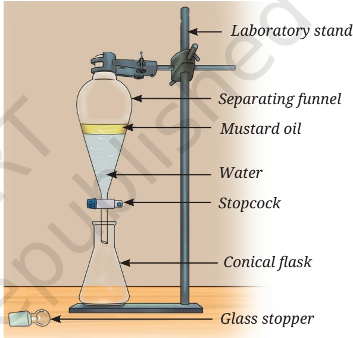

# 5.4 How Can We Separate the Components of Heterogeneous Mixtures?

## 5.4.1 Separation of two immiscible liquids

You have learnt about non-uniform mixtures. Have you noticed what happens when water falls into a container that has oil? The oil and water form separate layers. They do not mix and are called **immiscible** liquids. Similarly, sand and water do not mix, nor do iron filings and sulfur. These are examples of heterogeneous mixtures.

4 **Grade 8 Curiosity Chapter 9**

How can you separate the components of a mixture of two immiscible liquids?

Let us try to separate mustard oil from water.

## Activity 5.6: Let us separate

1. Pour a mixture of 5 mL mustard oil and 20 mL water into a 50 mL separating funnel.

2. Let it stand undisturbed. What do you observe?

3. You will see the formation of two separate layers of mustard oil and water (Fig. 5.16). The yellow-coloured mustard oil forms the upper layer and water forms the lower layer. Can you explain why?

4. Open the stopcock of the separating funnel slowly to collect the lower layer of water carefully into a container.

5. Close the stopcock when the water is almost fully drained.

Fig. 5.16: Separation of immiscible liquids

6. Collect the next small portion that may contain both liquids and discard it.

7. Collect the layer of oil separately by opening the stopcock again.

You now have two separate liquids.

Can you think of any heterogeneous mixtures with a gas as one of the components?

Gas particles are free to move in all directions, so they mix easily and uniformly with other gases. Hence, most mixtures of gases are homogeneous, such as a mixture of hydrogen and oxygen, which is used as a rocket fuel. On the other hand, smoke (solid particles suspended in air), fog (tiny liquid water droplets present in air) and dust in the air are some heterogeneous mixtures with gas as one of the components.

Most of the solid-solid mixtures are heterogeneous. You can use a property of one of the solids to separate the mixture. You have learnt how to separate iron nails from sawdust Grade 6 using a magnet. Now, let us explore another technique to CuriosityChapter separate solid-solid mixtures.

## What if

two immiscible liquids of the same density are mixed in a separating funnel, how will the layers form?