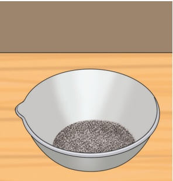
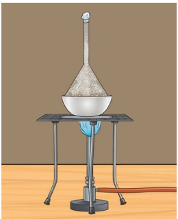
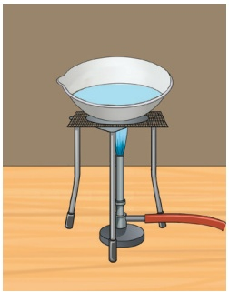
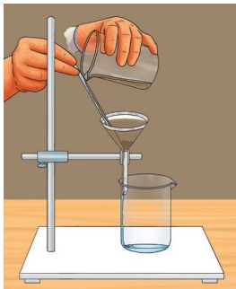

11. You are given a mixture of sand, common salt and naphthalene (Fig. 5.25a). The Fig. 5.25b depicts various steps used to separate the components of this mixture. Identify and write down the correct sequence of separation techniques.

Fig. 5.25: (a)

1

2

Fig. 5.25: (b)

3

12. Why is distillation an effective method for separating a mixture of water and acetone?

13. Answer the following questions with the help of the data given in Table 5.4.

Table 5.4: Solubility of various salts (in g per 100 g of water) at different temperatures

<table><tbody><tr><td rowspan="2">Salts</td><td colspan="6">Temperature (°C)</td></tr><tr><td>10 °C</td><td>20 °C</td><td>30 °C</td><td>40 °C</td><td>60 °C</td><td>80 °C</td></tr><tr><td>Potassium nitrate</td><td>21</td><td>32</td><td>45</td><td>62</td><td>106</td><td>167</td></tr><tr><td>Sodium chloride</td><td>36</td><td>36</td><td>36.3</td><td>36.5</td><td>37</td><td>37</td></tr><tr><td>Potassium chloride</td><td>35</td><td>35</td><td>37.4</td><td>40</td><td>46</td><td>54</td></tr><tr><td>Ammonium chloride</td><td>24</td><td>37</td><td>41</td><td>41</td><td>55</td><td>66</td></tr></tbody></table>

(i) What mass of potassium nitrate would be needed to prepare its saturated solution in 50 g of water at 40 °C?

(ii) A student makes a saturated solution of potassium chloride in water at 80 °C and leaves the solution to cool at room temperature (25 °C). What would she observe as the solution cools? Explain.

(iii) What is the effect of a change in temperature on the solubility of salts? Also, compare the changes in the solubility of the four given salts with increasing temperature from $1 0 \; ^ { \circ } \mathrm { C }$ to $8 0 \; ^ { \circ } \mathrm { C }$

14. Three students, A, B and C, are preparing sugar solutions for an experiment:

y Student A dissolves 20 g of sugar in 80 g of water.

y Student B dissolves 20 g of sugar in 100 g of water.

y Student C dissolves 30 g of sugar in 80 g of water.

(i) Calculate the mass percentage (% m/m) concentration of sugar in each student’s solution.

(ii) Whose solution is the most concentrated? Explain why.