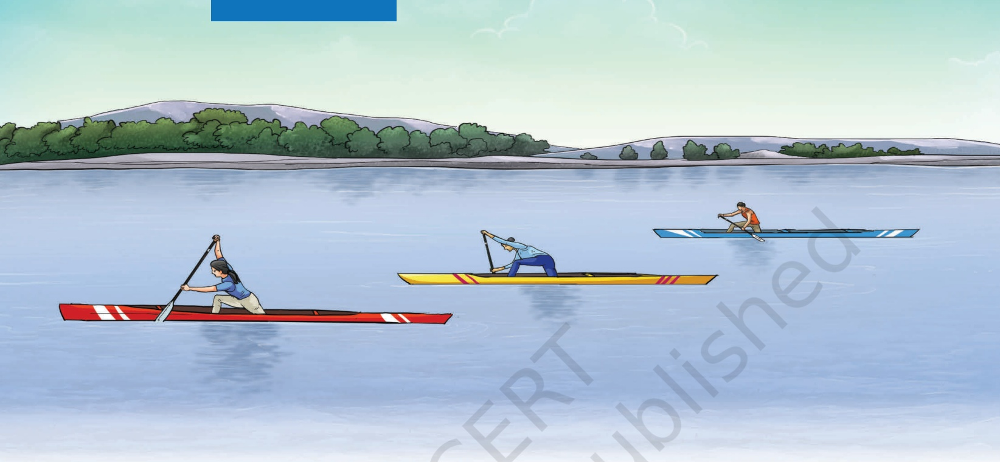
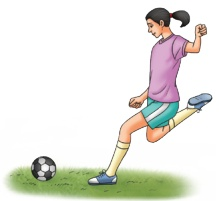
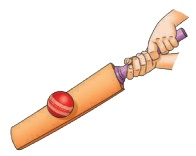
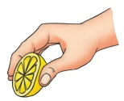

0906CH06

## Think It Over

Why does a canoe move forward when the canoeist pushes water backwards with their paddle and why does it move faster when they push harder?

y Suppose the same canoeist uses the same paddle force in two different canoes, one empty and one carrying another passenger. In which case will the canoe move faster?

In Chapter 4, you learnt to describe the motion of an object in terms of its position, velocity and acceleration. But you did not consider what causes motion. Is there an underlying cause for a change in position and velocity of an object? What is the nature of this cause? Do all motions require a cause? In this chapter, we will investigate what causes changes in the motion of objects. We will also discuss Newton’s three laws of motion and learn how to apply them.

## 6.1 The Concept of Force

Grade 8 You may recall learning earlier that a force can make an Curiosity object move from rest, change the speed and direction Chapter 5 of motion of a moving object, and can even change the shape of an object. For example, a ball at rest starts moving when you apply a force, a force applied by a cricket bat on a cricket ball changes its direction, and a lemon can be squeezed by the force applied by your fingers (Fig. 6.1).

(a) Kicking a ball

(b) Striking a ball

(c) Squeezing a lemon

Fig. 6.1: Applying force on different objects