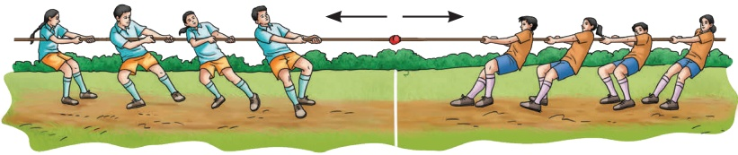
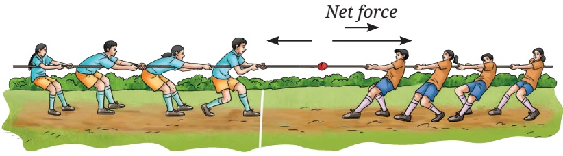
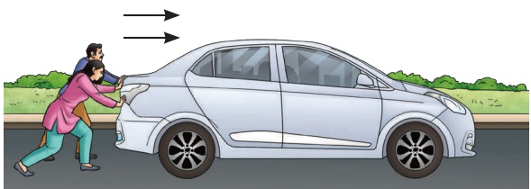
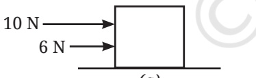
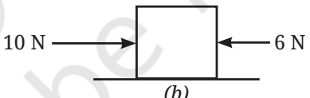
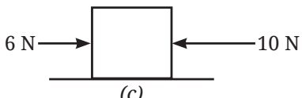
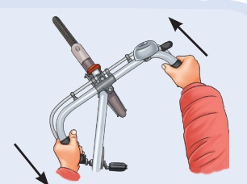

(a)

(b)

Fig. 6.4: Two forces applied in opposite direction of (a) equal magnitudes, (b) unequal magnitudes

force, the rope does not move (Fig. 6.4a). Such two forces, which are equal in magnitude but opposite in direction are called **balanced forces**. However, if one team pulls harder, i.e., it applies a force of larger magnitude, the forces are no longer balanced and the rope moves in the direction of the larger force (Fig. 6.4b). The rope does not move if the forces applied on it are balanced but moves if the forces are unbalanced.

If the forces applied on an object are not balanced, a non-zero **net force** acts on the object. When two forces are opposite in direction but unequal in magnitude (Fig. 6.4b), the magnitude of net force is equal to the difference between the magnitudes of two forces and the direction is along the force of the larger magnitude.

Fig. 6.5: Two forces applied in the same direction

Now, think of a situation where two people are applying forces in the same direction on a stalled car to make it move (Fig. 6.5). In this case, the magnitude of the net force applied by them on the car is the sum of the magnitudes of two forces. The direction of the net force is in the same direction as the two individual forces.

**Example 6.1:** Two forces of 10 N and 6 N are acting on a block lying on the table as shown in Fig. 6.6. What is the magnitude and the direction of the net force acting on the block in each case?

(a)

(b)

Fig. 6.6: Two forces acting on a block in three different manner

(c)

**Answer:**

(a) Net force $e = 10    N  + 6    N  = 16    N ,$ acting towards the right side.

(b) Net $\mathrm{force}=10\mathrm{~N}-6\mathrm{~N}=4\mathrm{~N}$ , acting towards the right side.

(c) Net force = 10 N – 6 N = 4 N, acting towards the left side.

## Ready to Go Beyond

There are situations in which forces do not act parallel or opposite to each other but act at an angle to each other. You will learn in higher grades how to calculate the net force in such cases. Also, there are situations where equal and opposite forces are applied to the two ends of an extended object which make the object rotate (Fig. 6.7). For example, applying equal and opposite forces to a handlebar or a tap makes it turn. You will also learn about this in higher grades.

Fig. 6.7: Equal and opposite forces on an extended object