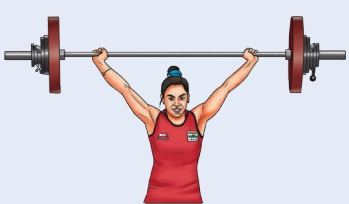
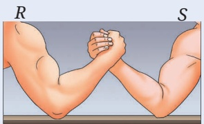
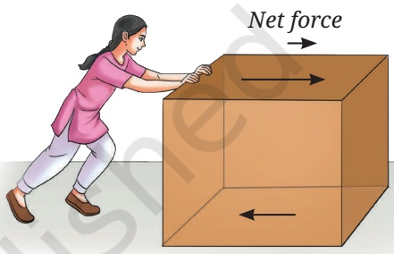
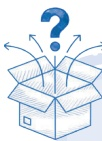
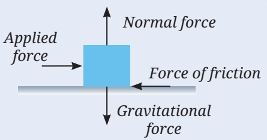

## Pause and Ponder

1. A weightlifter lifts a barbell (Fig. 6.8). List two forces that are acting on the barbell. Are these forces balanced if the weightlifter keeps the barbell steady?

2. Two players R and S are participating in an arm-wrestling match (Fig. 6.9). At the instant, when the arms tilt to the front direction (out of the page towards you), are the forces exerted by the players balanced? If not, which player exerted the larger force?

Fig. 6.8: A weightlifter lifting barbell

Fig. 6.9: Arm-wrestling match

## 6.3 The Force of Friction: Often Overlooked but Always Present

You have learnt about the force of friction in an Grade 8 earlier grade but now let us learn more about it. Curiosity Chapter 5 Suppose an object is kept at rest on the floor and you apply a force on it in the forward direction (Fig. 6.10). Will the force applied by you make the object move? Many a times, you might have experienced that on applying a force on an object, it did not move and you had to apply a larger force to move it. Why is it so?

Fig. 6.10: A box being pushed

It is due to the force of friction arising between the bottom surface of the box and the floor acting in a direction opposite to the direction of the force applied by you. The box will start moving when the force applied by you is of larger magnitude than the force of friction, so that a net force acts on the box in the direction of its motion.

## Note

Multiple forces may act on an object, but its motion depends only on the net force.

## Ready to Go Beyond

For an object being pushed, apart from the applied force and the force of friction, some other forces may also be acting on it (Fig. 6.11). One of these is the gravitational force (weight) and the other is the force exerted by the surface on which it is placed called the normal force. The weight acts in the downwards direction, whereas the normal force acts in the upward direction perpendicular to the surface. However, the two forces are balanced.

Air around the object also exerts a force of friction on the box when the box moves through the air, but in many cases its magnitude is so small that it can be neglected.

Fig. 6.11: Forces acting on an object

For the situation shown in Fig. 6.10, once the box starts moving and you stop applying the force on it, the box slows down and comes to a stop. You must have experienced this in many cases around you. You stop pedalling a bicycle and after some time it comes to rest after travelling some distance. You stop pushing a ball and it also comes to rest after travelling some distance. Does it mean that you need to continuously apply a force to keep