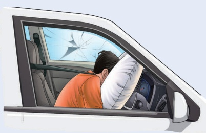
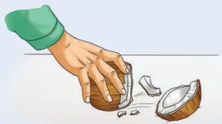

ball as it slows down, thus requiring a smaller force to be applied by the fielder to stop the ball. Applying a smaller force to the moving ball also minimises injury to the fielder.

## Bridging Science and Society

For a similar reason, airbags are provided in vehicles (Fig. 6.19). In the event of a collision and the vehicle coming to an abrupt halt, the airbag inflates quickly into a soft compressible cushion. Instead of directly hitting the hard steering wheel or dashboard, the passenger’s head and chest push into the bag, and the time over which the hitting occurs increases. Smaller acceleration means a reduced force exerted on the person, thereby lowering the risk of serious injuries, particularly when combined with the seat belt usage.

Fig. 6.19: Inflated airbag in a vehicle

Fig. 6.20: Cracking a coconut in one go

Have you ever attempted cracking a fresh coconut in one go? It is brought down at a very high velocity to hit a hard surface (Fig. 6.20). When the coconut hits the ground, it stops in a very short time. To change its velocity so quickly, the ground must exert a very large force on it. This large force breaks the shell.

**Example 6.4:** A weight lifter is holding a barbell with mass of 10 kg fixed on each side of the bar (Fig. 6.8). The mass of the bar itself is 10 kg. How much force is she applying to keep the barbell steady?

**Answer:** The total mass of the barbell is 30 kg. The gravitational force due to the Earth, acting on the barbell in the downward direction is (using Eq. 6.3),

$$
F = mg = 30\  kg  \times 9.8\  m \  s ^{-2} = 294\  N
$$

To keep the barbell steady, the weightlifter has to apply an equal force in the opposite direction. So, she is applying 294 N in the upward direction. **Example 6.5:** A student is trying to push a stationary block of 25 kg on a horizontal floor. The maximum force of friction opposing this motion is 50 N. Determine the displacement of the block in 2 seconds if Rahul pushes it with a constant force of (i) 50 N and (ii) 55 N in the forward direction.

**Answer:**

(i) The force applied by the student is equal to the opposing force of friction. Thus, the two forces are balanced and the net force acting on the block is zero. So, the block will remain stationary.

(ii) The net force on the block is 55 $N-50\;N=5\;N.$

The mass of the block is 25 kg. Using the Newton’s second law of motion, the acceleration of the block is

$$
a = \frac{F}{m} = \frac{5   N }{25   kg } = \frac{5   kg     m     s ^{-2}}{25   kg } = 0.2   m     s ^{-2}
$$

Using the kinematic equation, the displacement of the block in 2 seconds is $s = u t + \frac{1}{2} a t^2 = \left[ 0 \mathrm{~m} \mathrm{~s}^{-1} \times 2 \mathrm{~s} \right] + \left[ \frac{1}{2} \times 0.2 \mathrm{~m} \mathrm{~s}^{-2} \times (2 \mathrm{~s})^2 \right] = 0.4$ m in the forward direction.