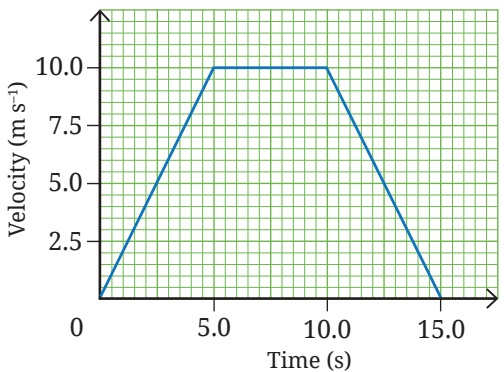

**Example 6.6:** A sports car of mass 1500 kg is moving towards the east and its velocity-time graph is shown in Fig. 6.21. Calculate the force acting on the car during

(i) 0 s to 5 s

(ii) 5 s to 10 s

(iii) 10 s to 15 s

## Answer:

Fig. 6.21: Velocity-time graph for a sports car

(i) During 0 s to 5 s:

As the velocity-time graph is a straight line inclined to the time axis, it indicates that the sports car is moving with a constant acceleration during this time interval with u = 0 m s–1, v = 10 m $\mathbb { S } ^ { - 1 }$ and t = 5 s.

Using the kinematic equation $\upsilon = u + a t ,$ we can find the acceleration,

10 m s–1 = 0 m s–1 + (a × 5 s)

a = 2 m s–2

Now, using the Newton’s second law of the motion F = ma, we can find the force acting on the sports car as,

F = 1500 kg × 2 m s–2 = 3000 N acting towards the east.

## (ii) During 5 s to 10 s:

As the velocity-time graph is a straight line parallel to the time axis, it indicates that the sports car is moving with a constant velocity. Hence, no force is acting on the sports car.

## (iii) During 10 s to 15 s:

As the velocity-time graph is a straight line inclined to the time axis, it indicates that the sports car is moving with a constant acceleration in this time interval with u = 10 m s–1, v = 0 m s–1 and t = 5 s. Using the kinematic equation v = u + at  , we can find the acceleration,

0 m s–1 = 10 m s–1 + (a × 5 s)

a = – 2 m s–2

Now, using the Newton’s second law of the motion F = ma  , we can find the force acting on the sports car as,

F = 1500 kg × (– 2 m s–2) = – 3000 N

The negative sign shows that the force is acting in a direction opposite to the direction of motion, that is towards the west.

## Pause and Ponder

6. A toy car of mass 100 g is moving with a constant velocity of 0.5 m s–1. What is the net force acting on the toy car?

7. Two children of different masses are sitting on identical swings. To impart identical initial acceleration, for which child would you require to apply a larger force? Explain why.

8. How are glass items packed for transportation using a bubble wrap or hay protected from damage?