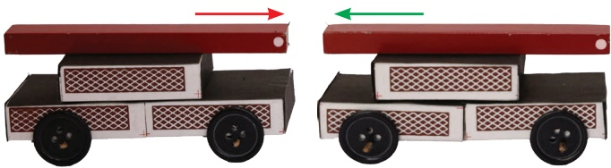
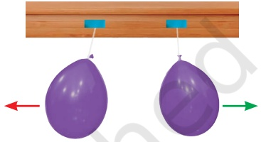
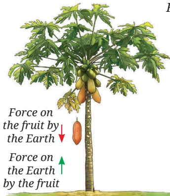

## Pause and Ponder

9. Why does a fireperson sometimes struggle when holding the pipe issuing water?

10. Suppose a spacecraft is moving in a region of space where the gravitational force acting upon it is negligible. Suggest how can it change its velocity.

**Grade 8** Curiosity **Chapter 5**

You have learnt about contact and non-contact forces earlier. Is Newton’s third law applicable only for contact forces? Newton’s third law applies to all types of forces, contact or non-contact, that we come across in everyday mechanical situations (Figs. 6.31, 6.32, 6.33).

Fig. 6.31: Two bar magnets applying equal and opposite magnetic forces on each other

Fig. 6.32: Two similarly charged balloons applying equal and opposite electrostatic forces on each other

**Example 6.7:** As shown in Fig. 6.33, the Earth and the fruit apply equal and opposite gravitational forces on each other. Then why does the fruit move towards the Earth while the Earth doesn’t seem to move towards the fruit?

**Answer:** Though the forces acting on both the Earth and the fruit are equal in magnitude; the mass of the Earth is so large (as compared to the fruit) that the acceleration of the Earth caused by the force is extremely small $\left( \operatorname{as} \operatorname{per} a = \frac{F}{m} \right)$ . Thus, its effect on the Earth is too small to be noticed.

Fig. 6.33: The Earth and the fruit applying equal and opposite gravitational forces on each other

## Note

**Example 6.8:** When a 0.1 kg bullet is fired from a 5 kg gun with a force of 2 N, the gun recoils. What are the magnitudes of initial accelerations of the bullet and the gun?

Even though the forces acting on the two interacting objects are always equal in magnitude, they do not, in general, produce equal acceleration. This is because the masses of the objects upon which they are acting may be different.

**Answer:** From the Newton’s third law of motion, the recoil force on the gun is also 2 N.

From the Newton’s second law of motion, the initial magnitudes of acceleration of gun

$$
\frac{ force }{ mass of Sun } = \frac{2\  N }{5\  kg } = 0.4\  m \  s ^{-2}
$$

While the initial acceleration of bullet

$$
\frac{ force }{ mass of bulk } = \frac{2 N }{0.1 kg } = 20  m  s ^{-2}
$$

Even though the pair of forces are equal in magnitude, the magnitudes of accelerations are not equal because their masses are different.