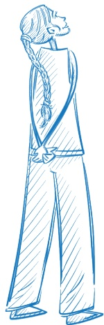
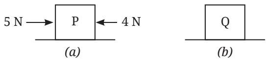

## At a Glance

The force of friction acts on an object in the direction opposite to its direction of motion.

Newton’s first law of motion: An object at rest remains at rest, and an object in motion continues to move with a constant velocity, unless a net force acts upon the object.

Newton’s second law of motion: When a net force acts on an object, the object accelerates in the direction of the net force. The magnitude of the acceleration is proportional to the magnitude of the net force and is inversely proportional to the mass of the object.

Newton’s third law of motion: Whenever one object is exerting a force on a second object, the second object is simultaneously exerting an equal and opposite force on the first object.

## Revise, Reflect, Refine

1. Using a horizontal force F, a table is moved across the floor at a constant velocity. How much is the frictional force exerted by the floor on the table?

2. For a ball moving on a smooth frictionless surface, choose the appropriate option that will make the following statements physically correct.

(i) If no net force is applied on the ball, the velocity of the ball will remain the same/increase/decrease.

(ii) If a net force is applied on the ball in the direction of its motion, the magnitude of the velocity of the ball will remain the same/ increase/decrease.

(iii) If a net force is applied on the ball in a direction opposite to the direction of its motion, the magnitude of the velocity of the ball will remain the same/increase/decrease.

3. Two blocks P and Q on a smooth horizontal surface are shown in Fig. 6.36a and Fig. 6.36b. Two forces of magnitudes 4 N and 5 N are acting in opposite directions on block P, while block Q is moving with a constant velocity.

Fig. 6.36

Which of the following statement is correct?

(i) P experiences a net force and Q does not experience a net force.

(ii) P does not experience a net force and Q experiences a net force.

(iii) Both P and Q experience a net force.

(iv) Neither P nor Q experiences a net force.