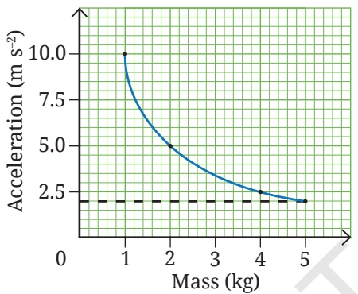
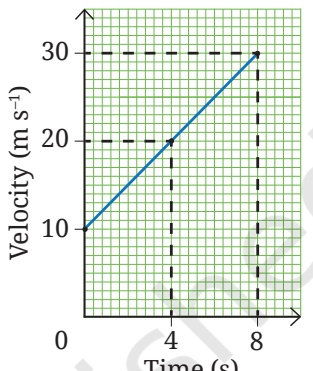
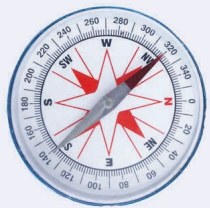

9. A hand cart loaded with vegetables collides with an identical but empty hand cart. During the collision:

(i) the loaded cart exerts a force of larger magnitude on the empty cart. (ii) the empty cart exerts a force of larger magnitude on the loaded cart. (iii) neither cart exerts a force on the other.

(iv) the loaded cart and the empty cart, both exert an equal magnitude of force on each other.

10. The acceleration-mass graph for the acceleration produced by a force on objects of different masses is plotted in Fig. 6.40. **Plot** the force-mass graph for this case.

Fig. 6.40

Fig. 6.41

11. The velocity-time graph of an object of mass 10 kg moving along a straight line is shown in Fig. 6.41. Calculate the force acting on the object by using the graph.

12. A bullet of mass 50 g moving with a speed of 100 m $S ^ { - 1 }$ enters a heavy stationary wooden block and stops after penetrating a distance of 50 cm. Estimate the stopping force acting on the bullet (assume that the bullet undergoes constant acceleration within the block).

13. An ace footballer converted a penalty shot by kicking the football with a speed of 108 km $\mathrm { h } ^ { - 1 }$ . The estimated force they imparted was 800 N. The mass of the football was 0.4 kg. Calculate the time of contact between their foot and the ball.

14. An object of mass 2 kg moving with a constant velocity of 10 m $S ^ { - 1 }$ encounters a rough patch where the force of friction on the object is 7 N. At the same time, an additional constant force of 3 N opposing the motion is applied on the object. After entering the rough patch, how much distance does the object travel before coming to rest?

Fig. 6.42: A bar magnet and a magnetic compass

15. A tractor pulls a harrow (a ploughing tool) of mass $m _ { \mathrm { { _ 1 } } }$ with a net force F resulting in an acceleration of $a _ { 1 } ,$ The same tractor pulls a trolley of mass $m _ { 2 }$ with a force F producing an acceleration of $a _ { 2 }$ . If the tractor now pulls the trolley with the harrow placed on it (with the same force F), then obtain an expression for the resulting acceleration in terms of $a _ { 1 }$ and $a _ { 2 } .$ Ignore friction.

16. When the pole of a bar magnet is brought close to a magnetic compass, the bar magnet and the compass needle (which is also a magnet) exert a magnetic force on each other. As per Newton’s third law of motion, both the forces are equal in magnitude and opposite in direction. However, the compass needle moves, whereas the bar magnet does not move (Fig. 6.42). Explain why.