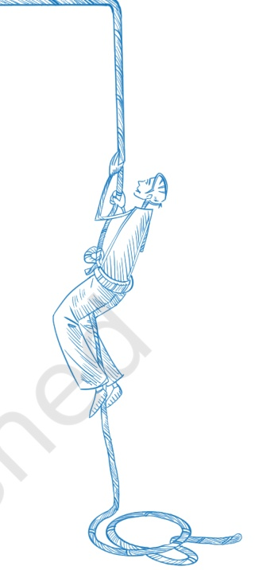

# The Journey Beyond

You know that the force of friction depends on the nature of the surfaces in contact. Does it also depend on how hard the surfaces press each other? Is the friction acting on an object that is about to move larger than the friction after motion begins? Is the friction which acts on a rolling object less than that on a sliding object? Find answers to these questions and **create** an infographic. Such observations help explain why the invention of the wheel was a major milestone in human history.

Take two toy cars of equal mass and stick a bar magnet on top of each (Fig. 6.32). Fix a metre scale on a smooth surface. Place the cars near the midpoint of the metre scale with the like poles touching. Release the cars and record the time taken (using two stopwatches), and distance travelled by each before coming to a rest. Repeat the experiment after adding equal masses to both cars. Did the cars travel equal distances in opposite directions? Plot a graph of distance travelled versus mass. **Analyse** and discuss your findings.

Wrap a rope once around a rough tree branch or post. Attach a heavy bucket to one end and try to hold it by the other end (Fig. 6.43). Now, add one more turn of the rope and repeat. You will find that each extra turn increases the ‘grip’ between the rope and the branch, increasing the friction and reducing the force required, making it much easier to hold the same load. The reduction in effort is much larger than you might expect from just adding one turn. This shows that friction does not increase in a simple linear way, small changes in contact can lead to large changes in force. In the same way, friction between a rope and a post allows large ships to be held safely at a pier.

y It is often instructive to examine how scientific ideas develop over time. If you are interested, explore how Newton formulated the laws of motion by reading excerpts from his original work, the Principia. Both the original text and commentaries are available online.

Fig. 6.43

## Ready to Go Beyond

Newton’s laws describe motion across an enormous range of scales, from everyday objects to planets and stars. They need modification only very close to massive objects, at extremely high speeds near the speed of light, and very small (atomic) scales.

## The Quest Continues…

In the real world, friction is always present whenever surfaces are in contact. Scientists have been trying to find ways to reduce friction between surfaces by using lubricants, coatings or texturing of surfaces, streamlining shapes of objects, and by using magnetic levitation.