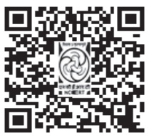
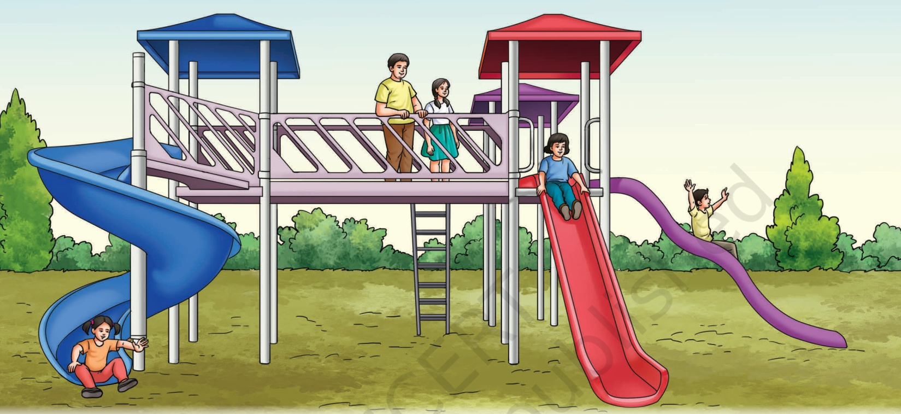
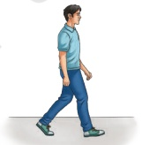
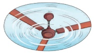
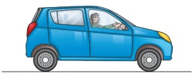

0906CH07

# Work, Energy, and Simple Machines

7

## Think It Over

What will be the magnitude of velocity of the child at the bottom of the blue slide?

Will two children of different masses reach the bottom of the same slide with the same velocity?

In earlier Chapters 4 and 6, you have learnt how forces change the motion of objects, and how kinematic equations and Newton’s laws can be used to analyse motion. But when forces change with time or act in complicated ways, applying these laws directly can become difficult. Is there a simpler and more powerful way to understand such situations?

Which of the slides will result in the largest magnitude of velocity for the child at its bottom?

In this chapter, you will explore the ideas of work, energy and power, which often allow us to **analyse** motion and interactions more easily. You will also learn about simple machines, which help us perform tasks with less effort and more convenience. These form the building blocks of many everyday machines. Energy, which is the capacity to do work, lies at the heart of all these ideas and of almost every activity in our daily life (Fig. 7.1).

Food provides energy to walk

Electricity provides energy to rotate a fan

Fuel provides energy to move a car

Fig. 7.1: Energy required to carry out tasks comes from various sources

We often use the words work, energy, and power in everyday conversations. As we learnt in Chapter 1, these terms have a precise meaning in science. Let us first understand how to **define** work.