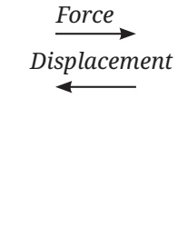
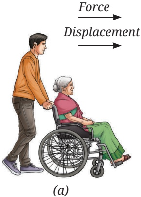
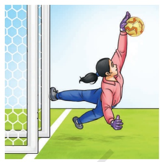

Positive work done by the boy on the wheelchair

when you push a wheelchair, the force applied by you on the wheelchair and its displacement are in the same direction (Fig. 7.7a). Thus, you do positive work on the wheelchair.

When the displacement is in the direction opposite to that of the force, then the work done by the force on the object is **negative**. For example, while stopping a ball, the goalkeeper applies a force in a direction opposite to the direction of motion of the football (Fig. 7.7b), and hence, opposite to the displacement. As a result, the goalkeeper does negative work on the ball.

Fig. 7.7: Examples of (a) positive, and (b) negative work done on object

(b)

Negative work done by the goalkeeper on the ball

## Note

**Example 7.1:** While exercising, a girl lifts a dumbbell and slowly lowers it down. Identify when the girl does positive work on the dumbbell and when she does negative work on it.

The ball and the goalkeeper, both apply equal and opposite forces on each other. Both do work on each other. The ball does positive work on the goalkeeper, while goalkeeper does negative work on the ball.

**Answer:** The girl applies a force equal to the weight of dumbbell to lift it up. When she moves the dumbbell up, the force is in the direction of displacement, so she does positive work on it. When moving the dumbbell down, the force she applies to hold it is in a direction opposite to the displacement, so she does negative work on it.

**Example 7.2:** While saving a goal (Fig. 7.7b), a goalkeeper’s hand moved back by 15 cm as she stopped a ball while applying a force of 200 N. How much work did the goalkeeper do on the ball in stopping it?

**Answer:** The goalkeeper applied a force opposite to the motion of the ball, so she did negative work on the ball. The displacement should be taken as negative because the ball moves in a direction opposite to the direction of the applied force.

Work done by the goalkeeper on the ball = force × displacement of ball in the direction of force

$$
200\mathrm{~N} \times (-0.15\mathrm{~m}) = -30\mathrm{~J}
$$

## Pause and Ponder

1. In the previous chapter, a weightlifter is shown holding a barbell steady in her hands (Fig. 6.8). Is she doing any work on the barbell while holding it steady?

2. Is the work done by friction on the stack of coins that travels on a rough surface (Fig. 6.13c) — positive, negative or zero?