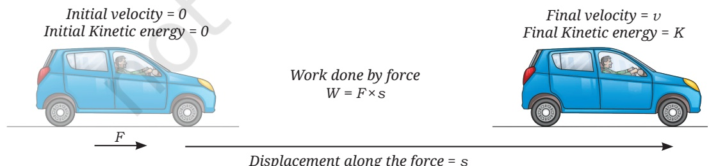
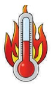

## Pause and Ponder

3. When you pedal a bicycle on a flat road, your muscles supply energy. In what forms does this muscular energy appear as you ride?

## 7.3 Forms of Energy

As we have seen, energy is the capacity to do work. The examples that we have discussed till now correspond to the mechanical energy. But energy can exist in many other forms as shown in Fig. 7.10. It is possible to change energy from one form to another. For example, electrical energy is converted

## 4 Grade 6 Curiosity Chapter 3

into light energy in a bulb, and into thermal energy of the water in an electric water heater. The chemical energy in the food we eat powers our muscles and gets converted into mechanical energy. Similarly, a ringing bell converts mechanical energy into sound energy.

Among these, we will now look more closely at mechanical energy, since it is directly connected to the forces and motions you studied earlier.

## 7.4 Mechanical Energy

Mechanical energy is the energy that an object possesses due to its motion or position. Let us try to quantify mechanical energy by using the concept of work.

## 7.4.1 Kinetic energy

The energy possessed by an object due to its motion is called **kinetic energy**. All moving objects possess kinetic energy, such as a moving bicycle or a rolling ball.

How much is the energy possessed by an object by virtue of its motion? It is common to define an object that does not move to have zero kinetic energy. Consider an object that starts from rest and acquires a certain velocity under the influence of a force F (Fig. 7.11). Then by the work-energy theorem, the work done by the force will equal to the energy gained by the object, which is the kinetic energy of the object in this case.

Initial velocity = 0 Initial Kinetic energy = 0

Work done by force W = F×s

Displacement along the force = s

**Mechanical energy** Energy due to motion or position of objects Energy that makes things warm or hot

Fig. 7.11: Calculating change in kinetic energy using the work-energy theorem

**Light energy** Energy that allows us to see

**Sound energy** Energy of vibrations of air or other molecules

Electrical energy Energy related to position or motion of charges

Nuclear energy Energy stored in the nuclei of atoms

Chemical energy Energy stored in fuels and food in the form of chemical bonds between atoms

Fig. 7.10: Different forms of energy

Let us find a mathematical expression for the kinetic energy. For that, we will first find a general expression for work done by a force on an object of mass m, starting not from rest but from an initial velocity u. Let v be its