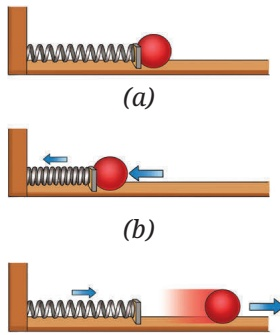
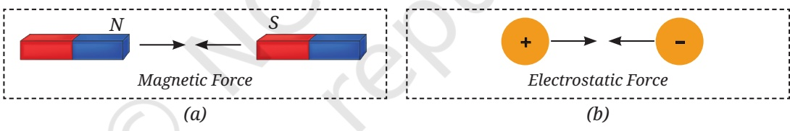
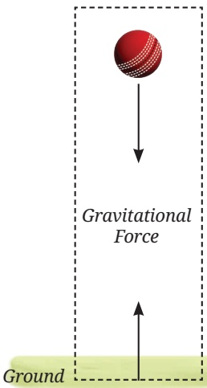

(c)

Fig. 7.14: Spring (a) in its original shape, (b) in compressed shape, and (c) moving back to its original shape

Similarly, when you apply a force and stretch or compress a spring (Fig. 7.14a), you do work on the spring to change or deform its shape. In turn, the spring stores energy or gains a capacity to do work while it is in a deformed state (Fig. 7.14b). While held in this state, the energy of the spring is due to its configuration or shape. When the spring is released, it comes back to its original shape. In the process, the spring transfers its stored energy to the kinetic energy of the object in contact (Fig. 7.14c).

## Ready to Go Beyond

You need to apply an external force to overcome the internal forces in the spring to deform it. Once you remove this external force, the internal forces undo the deformation, and in the process, it can carry out work. Thus, internal forces allow energy to be stored in a deformed object.

Energy can be stored not only by deforming an object, but also by changing the arrangement of objects in a system. You have learnt that like poles of the magnets repel each other, while unlike poles attract each other. You must have experienced that separating unlike poles of two magnets from each other requires applying a force. When unlike poles are separated from each other and released (Fig. 7.15a), they move towards each other and gain kinetic energy. In fact, a small pea kept in between the two strong magnets, could even be crushed by their kinetic energy. This shows that the system of two magnets when separated from each other, can store energy due to their relative positions.

Fig. 7.15: A system of two (a) magnets, and (b) electric charges

In the same way, a system of electric charges separated by a distance (Fig. 7.15b) also possesses the stored energy which can do work when released.

Now, consider a ball lying on the surface of the Earth. The ball Grade 8 and the Earth together form a system. You have learnt earlier Curiosity Chapter 5 that the Earth and ball attract each other. A force is required to do work against the gravitational force to lift the ball to some height. But once the ball is lifted to a height and the force is removed, the ball and the Earth rush towards each other, and attain kinetic energy in the process (Fig. 7.16). So, the system of ball and the Earth when separated from each other, store energy due to their relative positions.

Fig. 7.16: Earth ball system

More generally, whenever a system of objects interacts through forces, such as gravitational, electric or magnetic forces, the system can store energy due to the relative positions of the objects.

The energy stored by an object as a result of its deformation or in a system of objects due to their relative positions is called the **potential energy.**