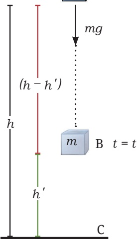

**Ready to Go Beyond**

Expression (Eq. 7.8) for the potential energy of an object at height h is valid only near the Earth’s surface. Further away from the Earth’s surface, the gravitational acceleration g decreases. You will learn about the gravitational potential energy of objects far from

the Earth in higher grades.

$$
\mathrm { ~ \textit ~ { ~ A ~ } ~ } t = 0
$$

Fig. 7.19 An object falling freely due to gravity

**Example 7.7:** After taking a catch, a fielder threw the cricket ball of mass 200 g high up in the air about 10 m above the ground in celebration. How much potential energy does the ball have when the ball reaches its maximum height? Assume $g = 10    m     s ^{-2}$

**Answer:** Using Eq. (7.8), the potential energy of the ball will be equal to

$$
mgh = 0.2    kg  \times 10    m     s ^{-2} \times 10    m  = 20    J
$$

## Pause and Ponder

6. Does the potential energy of an object near the surface of the Earth change if it moves with constant velocity in the horizontal direction? What if the object is gradually raised in the vertical direction?

## Ready to Go Beyond

Work done on a system against its internal forces, such as gravitational, electric or magnetic forces, can result in a gain of the potential energy of the system. But this is not true for all internal forces. For example, Next work done against friction does not lead to a storage of energy. Level Up You will learn how to identify such forces in higher grades.

## 7.4.3 Conservation of mechanical energy

The sum of the kinetic energy and the potential energy of the object is called its **mechanical energy**. Let us find the mechanical energy of an object at different points as it falls freely due to the gravitational force.

Once again, consider an object with mass m which has been lifted to a Point A at height h and dropped (Fig. 7.19). Its initial velocity u is equal to zero.

Thus, at point A (using Eqs. 7.6 and 7.8):

$$
\mathrm { p o t e n t i a l \; e n e r g y \; o f \; t h e \; o b j e c t = m g h }
$$

$$
kinetic energy of the object = 0\tag{7.9a}
$$

(7.9b)

$$
\mathrm{mechanism\ energy}=0+mgh=mgh\tag{7.9c}
$$

As the object falls due to the gravitational force (mg) for a time t till point B, its velocity increases to a value v. You can find the velocity v of the object and the height $h ^ { \prime }$ of point B from ground by using the kinematic equations (Use acceleration a to be equal to the acceleration due to gravity $g )$

$$
v = u + g t = 0 + g t = g t
$$

$$
s = u t + \frac{1}{2} g t^2 \rightarrow h - h' = 0 + \frac{1}{2} g t^2 \rightarrow h' = h - \frac{1}{2} g t^2
$$

Thus, at point B:

$$
potential energy of the object  = mgh' = mgh - \frac{1}{2}mg^2t^2\tag{7.10a}
$$

$$
kinetic energy of the object  = \frac{1}{2}mv^{2} = \frac{1}{2}mg^{2}t^{2}\tag{7.10b}
$$

$$
\mathrm{mechanism\ energy} = mgh - \frac{1}{2}mg^{2}t^{2} + \frac{1}{2}mg^{2}t^{2} = mgh\tag{7.10c}
$$