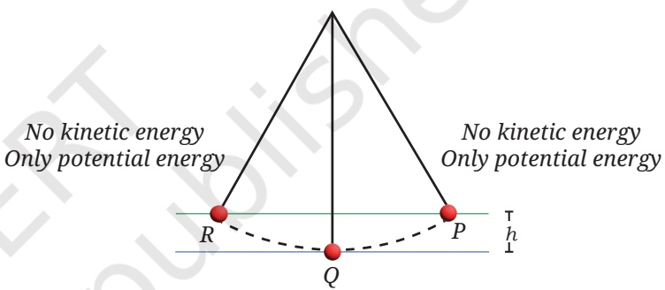

As the object falls down with time t, its potential energy decreases while its kinetic energy increases. Comparing Eq. (7.9) and Eq. (7.10), you find that at time t, the increase in the kinetic energy is equal to $\frac { 1 } { 2 } m g ^ { 2 } t ^ { 2 }$ , which is also equal to the decrease in the potential energy, $\frac { 1 } { 2 } m g ^ { 2 } t ^ { 2 }$ . This shows that the lost potential energy of the object is converted into kinetic energy during motion, while its mechanical energy remains constant and equal to mgh.

As an object moves due to the gravitational force, its mechanical energy remains the same, i.e., the mechanical energy of the object is conserved if no other external forces act on it. This is called the **conservation of mechanical energy**.

Let us conduct an activity to understand this. Do you remember experimenting with a simple pendulum earlier? Let us use that simple pendulum again to experiment further.

**Activity 7.2: Let us experiment**

1. Set up a simple pendulum as you have learnt in Grade 7.

2. Paste a white sheet of paper on a wall behind the pendulum. Draw a horizontal line above the position of the bob when it is not oscillating (Fig. 7.20).

3. Take the bob to one side to a point P, which is at the level of the horizontal line and let it go. **Observe** it at the extreme points of the first couple of oscillations. Does the bob almost reach the level of the horizontal line?

Only kinetic energy No potential energy

Fig. 7.20: A pendulum

At point P, the pendulum bob has the potential energy equal to mgh, where h is the height from the bottom-most point. At point Q, the potential energy is zero, but the pendulum has kinetic energy. Finally at point R, on the other side of the pendulum where it stops, the kinetic energy is zero but the pendulum bob regains its potential energy. The pendulum bob reaches almost the same height it started with. This **demonstrates** that the mechanical energy of the bob remains constant. However, in real life, the pendulum slows down and eventually stops because of energy loss due to friction at the support and air resistance.

The conservation of mechanical energy can often be useful in solving several real-life problems.

## Ready to Go Beyond

Mechanical energy is just one part of a bigger picture. In nature, energy can appear in many different forms. Scientists have discovered that the total energy of an object or system of objects which is not acted upon by any external forces, stays constant.