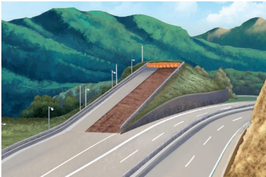

**Threads of Curiosity**

Solving problems directly through Newton’s laws can become cumbersome in many cases. Conservation of mechanical energy may offer a simpler route. By keeping track of the total mechanical energy, we can often find the final speed or the position of an object without working through all the detailed steps of the intermediate motion of an object.

**Answer:** Potential energy of the child at the top of the slide = mgh

Let the magnitude of velocity of the child on reaching the bottom of the slide be v. Then, the kinetic energy of the child at the bottom of the slide ${ = } { \frac { 1 } { 2 } } m \nu ^ { 2 }$

The potential energy of the child at the top of the slide gets converted entirely to the child’s kinetic energy at the bottom of the slide (neglecting the effects of friction). Thus, equating the two, we obtain

$$
\frac { 1 } { 2 } m \upsilon ^ { 2 }   = m g h
$$

$$
\nu = { \sqrt { \left( 2 g h \right) } } .
$$

As this velocity of the child at the bottom of the slide depends only upon the height h, the shape of the slide or the mass of the child should not matter. **Example 7.9:** Escape ramps (Fig. 7.21) are inclined planes filled with sand or gravel that help stop trucks when their brakes fail on a highway. A truck of mass 10000 kg is moving at 72 km $\mathrm { h } ^ { - 1 }$ when its brakes fail. The driver steers it onto an escape ramp inclined at 30°, where the truck comes to a rest. If the sand exerts a force of 50000 N opposite to truck’s motion, what is the minimum length of the ramp to be able to stop such a truck? Take $g = 10    m     s ^{-2}$ (Hint: For a $3 0 ^ { \circ }$ incline, the truck rises 1 m vertically for every 2 m it travels along the ramp).

Fig. 7.21: Escape ramp

nswer: e oc y o e ruc m A V l it f th t k = 72 k $\mathrm{h}^{-1}=20\mathrm{~m}\mathrm{~s}^{-1}$

Initial kinetic energy of the truck $\frac{1}{2}mv^{2}=\frac{1}{2}\times10000\  kg \times\left(20\  ms ^{-1}\right)^{2}$

Initial potential energy of truck = 0 J

Total initial energy of truck = Initial kinetic energy + Initial potential energy = 2000000 J + 0 J = 2000000 J

Let us assume that the truck travels a distance d along the ramp. Then, Height gained by the truck on $\operatorname { r a n p } = { \frac { d } { 2 } }$ (using hint given in the question) Final kinetic energy of truck = 0 J

Final potential energy of truck mg   = × $\frac{d}{2}=10000\mathrm{kg}\times10\mathrm{ms}^{-2}\times\frac{d}{2}=50000\mathrm{N}\times d$ Total final energy $=0\;J+50000\;N\times d$

Change in total energy of the truck = Final energy – Initial energy = (50000 N × d) – 2000000 J

Work done by sand on truck = – 50000 N × d

Using work-energy theorem,

Work done by sand on truck = Change in total energy of the truck

$$
-50000\mathrm{~N} \times d = (50000\mathrm{~N} \times d) - 2000000\mathrm{~J}
$$