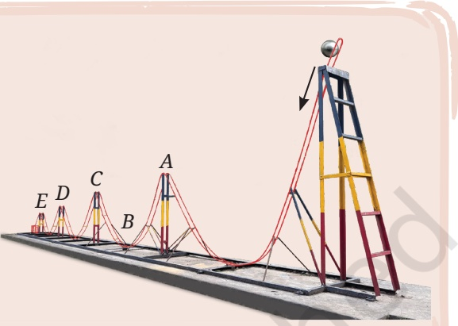

$$
2000000\mathrm{J}=(50000+50000)\mathrm{N} \times d
$$

$$
d=\frac{2000000\mathrm{~J}}{100000\mathrm{~N}}=\frac{2000000\mathrm{~N}\mathrm{~m}}{100000\mathrm{~N}}=20\mathrm{~m}
$$

Thus, the minimum length of the ramp to be able to stop such a truck is 20 m.

## Pause and Ponder

7. For the situation depicted in Fig. 7.19, calculate the mechanical energy of the ball just before it hits the ground and show that even at this position, it is mgh.

8. You may have seen an exhibit like that in Fig. 7.22 in a science park, where a ball is released from the highest point. Describe how the kinetic energy and potential energy change at points A, B and C. Why do subsequent points, such as C, D and E, usually have lower heights compared to the previous ones? Could it have anything to do with the energy lost due to friction?

Fig. 7.22: Ball roller coaster in a science park

## 7.5 Power

Suppose you carry your bag up a flight of stairs to your classroom. Running up the stairs in one minute feels very different than walking up slowly in five minutes, even though the same work is done in both cases. This difference is described by a physical quantity called power.

**Power** is defined as the rate at which work is done. Mathematically, the average power P is the work done W, divided by the time taken t, i.e.,

$$
P   =   \frac { W } { t ^ { \prime } }\tag{7.11}
$$

To do more work in the same time interval, requires more power. To do the same amount of work but in a shorter time interval also requires more power. The **SI unit of power** is the **watt (W)**, where 1 watt is equal to 1 joule of work done per second, i.e., 1 $\mathsf { W } = 1 \; \mathrm { J } \; \mathrm { s } ^ { - 1 }$

**Example 7.10:** A weightlifter lifts a 75 kg mass by 2 m in 5 seconds. How much power would she require for this task?

**Answer:** The work done would be equal to

$$
\begin{aligned}mgh &= 75   kg  \times 10   m   s ^{-2} \times 2   m  \\&= 1500   J \end{aligned}
$$

Thus, the power required will be $\frac{1500\  J }{5\  s } = 300\  W$

**Example 7.11:** A car of mass 1000 kg starts from rest and reaches a speed of 72 km $\mathrm { h } ^ { - 1 }$ in 10 seconds. Calculate the power of the engine required to achieve this start.

**Answer:** Final velocity, v = 72 km $h^{-1} = \frac{72000    m }{3600    s } = 20    ms ^{-1}$

while initial velocity $u = 0   \mathrm { m } \; \mathrm { s } ^ { - 1 }$

## Threads of Curiosity

You may have heard about another unit called horsepower (hp) used to measure power, especially for car engines, or pumps used to lift water. One horsepower is equal to 746 W. In the early days, when engines were newly discovered, the powers of engines were compared to the power of actual horses which were used to drive carriages.