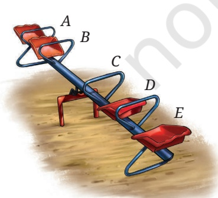

4. Place 1 coin in the left pan (call it effort) and 1 identical coin in the right pan (call it load). Observe that the beam stays horizontal.

5. Add one more coin to the right pan, so that it contains 2 coins. The beam tilts. Move the heavier pan closer to the centre of the beam to balance the beam. **Measure** its distance from the centre.

6. Repeat step 5 with 4 coins and then 8 coins in the right pan. Each time, note its distance from the centre that balances the beam.

7. **Record** all observations and measurements, and complete the Table 7.1 by adding more rows.

Table 7.1: Number of coins in the left pan and its distance from the fulcrum

| Number of Coinsin left pan,$n _ { 1 }$(Effort) | Distance of leftpan from thefulcrum,$L _ { 1 }$(cm) | Number of coinsin right pan,$n _ { 2 }$(Load) | Distance of rightpan from thefulcrum,$L _ { 2 }$(cm) |
| --- | --- | --- | --- |
| 1 |  | 1 |  |
| 1 |  | 2 |  |

By analysing the values recoded in Table 7.1, you can **conclude** that the beam balances when

$$
n_{1} \times L_{1}^{*} = n_{2} \times L_{2}
$$

Or,

$$
\mathrm{effort} \times \mathrm{effort} \; \mathrm{arm} = \mathrm{load} \times \mathrm{l} \; \mathrm{load} \; \mathrm{arm}\tag{7.15}
$$

If the effort arm is increased, the effort required to move the same load is reduced. You can calculate the mechanical advantage of the lever by using Eq. (7.12). Thus,

$$
\mathrm{mechanism\_advantage} = \frac{\mathrm{load}}{\mathrm{effort}} = \frac{\mathrm{effort\ arm}}{\mathrm{load\ arm}}\tag{7.16}
$$

Hence, by increasing the effort arm, the lever applies a larger force $F _ { 2 }$ to the load than the effort $F_{1}^{\cdot}$ The lever thus allows us to gain a mechanical advantage equal to the ratio of the distances, i.e., $\frac { L _ { 1 } } { L _ { 2 } }$

With the use of a lever, the effort required is generally smaller but it has to move by a larger distance such that the total work done by the agency applying effort remains the same.

Fig. 7.34: A seesaw

**Example 7.13:** For a seesaw having four seats A, B, D, E and fulcrum at C (Fig. 7.34), AC = EC = 2 m and BC = DC = 1 m. On which seats should children of masses 15 kg and 30 kg sit to make the seesaw balanced?

**Answer:** Suppose the child of mass 15 kg sits on seat A and the other child sits at a distance L from the fulcrum. Using Eq. (7.15), we obtain

$$
15\; kg  \times 2\; m  = 30\; kg  \times L
$$

$$
L = 1   \mathrm { m }
$$

Thus, the other child should sit at seat D.