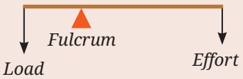
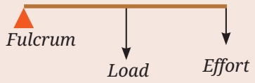
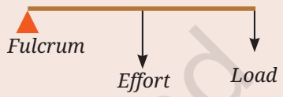
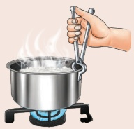
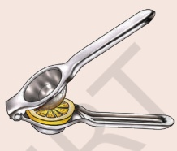
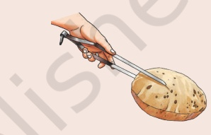
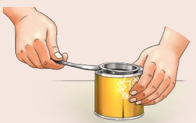

Levers can be of three classes depending upon the relative positions of effort, fulcrum and load, as shown in Table 7.2.

Table 7.2: Classes of Levers

<table><tr><td colspan=3>Levers</td></tr><tr><td>Class I</td><td>Class II</td><td>Class III</td></tr><tr><td>Fulcrum in between</td><td>Load in between</td><td>Effort in between</td></tr><tr><td></td><td></td><td></td></tr><tr><td></td><td></td><td></td></tr><tr><td>Tongs, scissors, crowbar,pliers, balance scale, seesaw</td><td>Lemon squeezer, wheelbarrow, bottle opener</td><td>Tongs, tweezers, broom,hammer, oar</td></tr></table>

Many machines used in daily life are made up of two or more simple machines. The next time you see a machine, try to identify the simple machines within them.

In all cases, the conservation of mechanical energy holds. The work we put in is equal to the useful work done on the load, ignoring friction. Machines do not create energy, they only help us use it more effectively.

## Pause and Ponder

11. Why is it easier to open the lid of a can by using a spoon as shown in Fig. 7.35?

12. Why do you push an object closer to scissors fulcrum when you want to cut an object which is hard?

13. Throughout history, many designs of perpetual machines (using wheels, weights or magnets) have been proposed but none actually work.

Fig. 7.35: Opening the lid by using a spoon

Why do all real machines eventually slow down and stop? Explain in terms of work and energy.

## What If

it were possible to build a perpetual motion machine, which once started, could continue doing useful work forever, without any fuel or electricity?