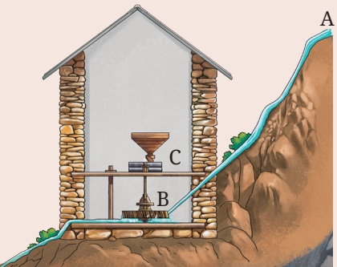
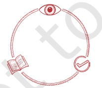

In the Himalayan region, water flowing downhill converts its potential energy into kinetic energy. Traditionally, this energy was used in devices, such as the gharat or panchakki — a water mill used to grind grain (Fig. 7.36). These can still be found in hilly regions.

The water starts from the top with potential energy. This potential energy gets converted to kinetic energy as it comes down the pipe (A). The kinetic energy of the water drives the wheel (B) and sets it into rotational motion. The wheel is connected to the grinding stone at the top (C).

In modern times, the potential energy of the water stored in dams is similarly converted into kinetic energy to generate electricity.

Fig. 7.36: A watermill (gharat or panchakki)

## At a Glance

Work is done by a force on an object, when the force displaces the object in the direction of the force.

y An object having capacity to do work is said to possess energy.

Work-energy theorem: Work done on an object or a system, is equal to the change in its energy.

The energy possessed by an object due to its motion is called kinetic energy.

The energy stored by an object as a result of its deformation or in a system of objects due to their relative positions is called potential energy.

y Power is defined as the rate at which work is done.

Simple machines are devices that make work easier by changing the magnitude or direction of the force that needs to be applied, though they do not reduce total work.

## Revise, Reflect, Refine

1. State whether True or False.

(i) Work is said to be done when a force is applied, even if the object does not move.

(ii) Lifting a bucket vertically upward results in positive work done on the bucket.

(iii) The SI unit for both work and energy is joule (J).

(iv) A motionless stretched rubber band has kinetic energy.

(v) Energy can change from one form to another.