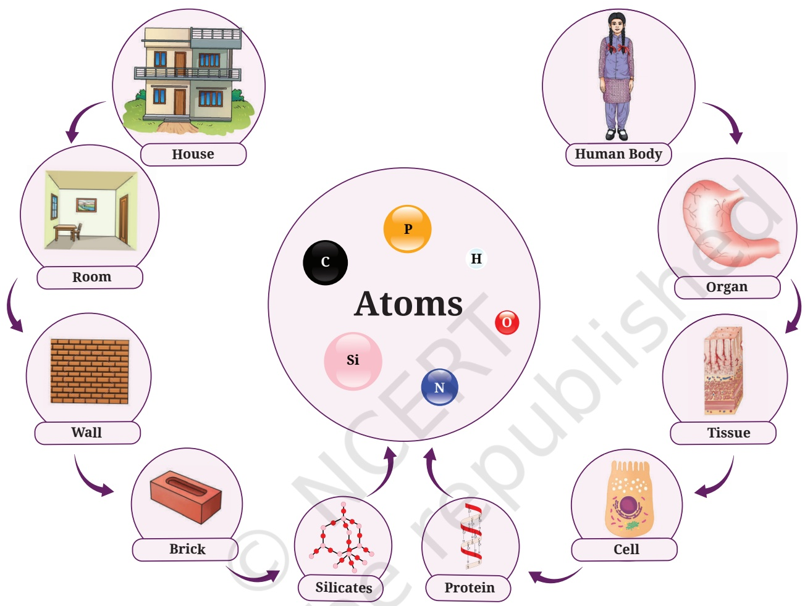

0906CH08

# Journey Inside the Atom

## Think It Over

Are atoms the smallest indivisible particles?

Why do electrons not fall into the nucleus even though they are attracted to protons in it?

Why did scientists keep modifying atomic models?

4 **Grade 8** Curiosity **Chapter 7**

Everything that you see or **observe**, or feel around is **matter**. You have learnt that matter consists of tiny par c es ca e a oms. a e a c oser oo a e p c ure ti l ll d t T k l l k t th i t given above. What do you observe? Do you **notice** that both living beings, like us, and non-living things, like a house, are ultimately composed of atoms? These atoms are so tiny that they cannot be seen with the naked eye.

You may be wondering — Is an atom truly the smallest unit of matter, or can it be divided even further?

Scientists, too, have been exploring whether atoms are divisible. If so, what are their constituents and how are these arranged? Let us **examine** how the concept of atoms emerged and how it has been evolved since then.