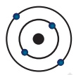
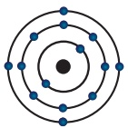
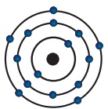
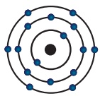
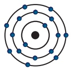
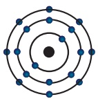

## 8.7 How Are Electrons Distributed in Different Energy Levels?

Bohr and Bury suggested the following rules:

y The maximum number of electrons present in a shell is given by the formula **2n²**, where ‘n’ is the number of the shell (Fig. 8.7). Hence, K-shell (n = 1) $2 \times 1 ^ { 2 } = 2 ,$ , can accommodate 2 electrons, L-shell (n = 2) 2×2² = 8 electrons, and M-shell (n = 3) 2×3² = 18 electrons.

y The maximum number of electrons that can be accommodated in the outermost shell is 8 (the first shell can accommodate a maximum of two electrons).

y Electrons are filled in these shells in a stepwise manner, starting from the one closest to the nucleus and moving outward, i.e., in the order K, L, M, N, … The L-shell will be filled only after the K-shell is complete, and so on.

To understand the placement of electrons in atoms, let us begin with hydrogen (atomic number 1). The only electron in it has to be in the K-shell. The electron distribution for hydrogen (H) is depicted in Fig. 8.11. Helium contains two protons in its nucleus and two electrons. In which way will the two electrons be arranged in its atomic shell?

## 8.7.1 Building up atoms

Let us create two-dimensional (2-D) atomic structures for various elements by adding one electron to the appropriate energy level each time atomic number is increased by 1. The distribution of electrons among various shells is known as the **electronic configuration** of the atom (Fig. 8.11). Table 8.4 lists the symbols, atomic numbers, number of protons, number of neutrons, number of electrons, and the electron distribution in the shells of the first eighteen elements.

H

He

Li

Be

B

C

N

0

F

Ne

Na

Mg

Al

Si

P

S

Cl

Ar

Fig. 8.11: Schematic atomic structure of the first eighteen elements showing how the electrons are filled in the K, L and M shells