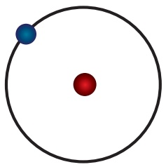
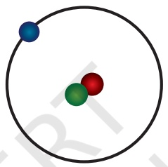
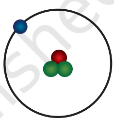
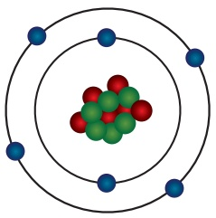
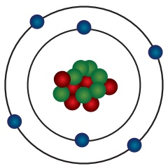
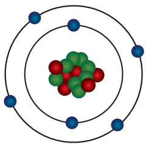

## 8.9 A Deeper Look into Atomic Structure

## 8.9.1 Isotopes

Dalton proposed that all atoms of an element are identical and have the same mass. But scientists later discovered that there were atoms of the same element that could have the same number of protons (atomic number, Z) yet could have different numbers of neutrons, and thus, different mass numbers $( A = p ^ { + } + n ^ { 0 } )$ . These ʻtwin atomsʼ with the same atomic number but different mass numbers are called **isotopes**.

Let us take hydrogen as an example. Naturally occurring hydrogen is a mixture of three different isotopes: $^ 1 _ { 1 } \mathrm { H }$ (protium, \~99.98%), $\frac { \phantom { \frac { 1 } { 2 } } } { 1 }$ H (deuterium, \~0.015%), and $^ 3 _ { 1 } \mathrm { H }$ (tritium, in traces) (Fig. 8.12). All of these contain one proton each, whereas deuterium contains one neutron, and tritium contains two neutrons. Can you guess how many electrons each of these isotopes have?

Protium

Deuterium

Tritium

Fig. 8.12: Schematic representation of isotopes of hydrogen

## Ready to Go Beyond

Atoms are too tiny to be weighed in kilograms or grams like everyday objects. Just as it is easier to weigh a grain of wheat in milligrams rather than kilograms, scientists use a special unit called the unified atomic mass unit (u) to measure the mass of atoms. This is because a kilogram is too large for such small particles. Earlier, atomic mass was expressed in atomic mass unit (abbreviated as ‘amu’).

The chemical properties of isotopes are similar. Do you know why? It is so because they have the same number of electrons and the same electronic configuration. As you have learnt, chemical properties depend mainly on the number of valence electrons. All the isotopes will have the same chemical properties although they differ in their physical properties, for example, boiling and melting points.

Similarly, carbon has three isotopes: ${ } _ { 6 } ^ { 1 2 } \mathsf { C } , { } _ { 6 } ^ { 1 3 } \mathsf { C } ,$ and ${ } _ { 6 } ^ { 1 4 } \mathbb { C }$ (Fig. 8.13). Each of these has six protons and six electrons. 12C is the most abundant isotope in nature. You may note that 6 these three isotopes differ in terms of the number of neutrons in them.

Carbon – 12

Carbon – 13

Fig. 8.13: Schematic representation of isotopes of carbon

Carbon – 14

Let us learn about the essential uses of some isotopes in our daily lives.