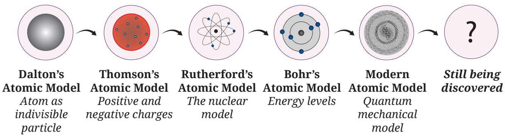

Fig. 8.16: Journey of the development of atomic models

## At a Glance

y Atoms are the building blocks of matter.

J. J. Thomson proposed that in an atom, electrons are embedded in a positively charged sphere.

Rutherford’s model described the atom as mostly empty space, with a dense, positively charged nucleus at its centre and electrons orbiting it.

Niels Bohr’s model proposed that electrons move in fixed energy levels (shells) around the nucleus.

The shells of an atom are named as K, L, M, N, and so on.

y James Chadwick discovered the presence of neutrons in the atom.

The three subatomic particles of an atom are electrons, protons, and neutrons.

If the outermost shell of an atom has an octet of electrons (or two electrons in case of helium), the atom is stable and largely unreactive.

Valency is the combining capacity of an atom. It is equal to the number of electrons which can be gained, lost or shared by an atom to achieve a stable configuration.

The atomic number of an element is equal to the number of protons in its nucleus.

The mass number of an atom is equal to the total number of nucleons (protons and neutrons) in its nucleus.

Isotopes are atoms of same element that have the same atomic number but different mass numbers.

The average atomic mass of an element is calculated based on the relative abundance of its isotopes in nature.

Isobars are atoms of different elements with the same mass number but different atomic numbers.

