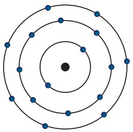
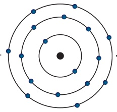
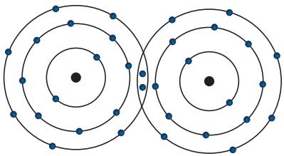
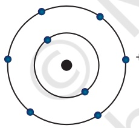
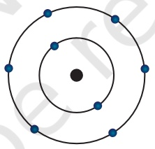
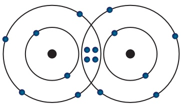

## Pause and Ponder

8. Nitrogen has five valence electrons. Draw the structure of the nitrogen molecule (N ).

9. The atomic number of fluorine is 9. Explain the formation of the fluorine molecule (F2).

## Together we are strong

Just as atoms share electrons to form covalent bonds, we too, can share and care to build strong relationships with people around us. This sharing brings unity and stability, laying the foundation for a stronger community, and ultimately, a strong nation.

The chlorine atom has seven electrons in its valence shell. Each chlorine atom requires one electron to attain a stable electronic configuration. A chlorine molecule is formed by the sharing of one electron each by two chlorine atoms, as shown in Fig. 9.7. This shared pair of electrons holds the two chlorine atoms together as a molecule.

Chlorine atom

Chlorine atom

Chlorine molecule

Fig. 9.7: Formation of a chlorine molecule

Since, the two atoms that share one electron pair are said to be bonded by a single covalent bond, the chlorine (Cl ) molecule can be represented as Cl— Cl.

Let us explore the bonding in an oxygen molecule.

Write down the electronic configuration of the oxygen atom (atomic number 8). You can observe that the number of electrons present in its valence shell is six, and it requires two more electrons to complete its octet.

So, two oxygen atoms share two electrons each, forming an oxygen molecule (O ), as shown in Fig. 9.8.

Oxygen atom

Oxygen atom

Oxygen molecule

Fig. 9.8: Formation of an oxygen molecule

In this case, the two atoms are joined by two pairs of shared electrons, and are held together by a **double bond**. It can be depicted by drawing two lines between two oxygen atoms as O=O.

## B. Molecules of compounds

In the section 9.4.1A, you learnt about the formation of molecules of elements, where two atoms of the same element combine. What happens if atoms of two different elements combine? Let us understand by taking an example of the formation of hydrogen chloride molecule.

You can do it by using the following steps:

y Write the electronic configurations of hydrogen and chlorine atoms (atomic number of hydrogen is 1 and chlorine is 17).

Calculate the number of electrons required by chlorine to complete its octet and by hydrogen to complete its duplet.