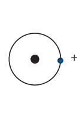
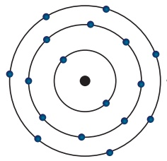
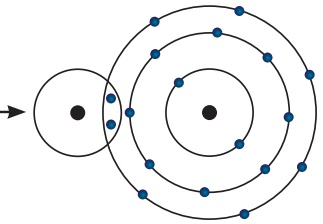
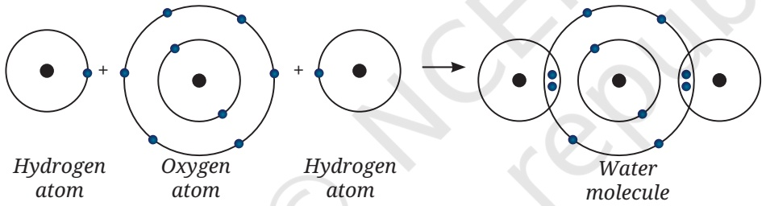

You must have noticed that atoms of both hydrogen and chlorine need one electron each to attain stable electronic configurations. Hence, both the atoms share one electron each to form a molecule of hydrogen chloride, as shown in Fig. 9.9.

Hydrogen atom

Chlorine atom

Hydrogen chloride molecule

Fig. 9.9: Formation of a hydrogen chloride molecule

Since the hydrogen and chlorine atoms in a hydrogen chloride (HCl) molecule bond by sharing electrons, it is a covalent compound. Also, since hydrogen and chlorine atoms share one pair of electrons, they are bonded by a single bond and it can be depicted as H— Cl.

You know that hydrogen and oxygen combine to form water. Hydrogen needs only one electron, while oxygen needs two electrons to acquire stable electronic configurations. How can oxygen share its two electrons with another atom that requires only one electron? This is achieved by two hydrogen atoms sharing an electron each with an oxygen atom, as shown in Fig. 9.10.

Hydrogen atom

Oxygen atom

Hydrogen atom

Water molecule

Fig. 9.10: Formation of a water molecule

Thus the water molecule formed is represented as $\mathrm { H _ { 2 } O , }$ which indicates the presence of two hydrogen atoms and one oxygen atom.

## Pause and Ponder

10. Show the formation of the following molecules:

(i) Carbon dioxide (CO2)

(ii) Hydrogen sulfide $( \dot { \mathrm { H } } _ { 2 } \mathrm { S } )$

(iii) Ammonia (NH )

11. Neon (atomic number 10) neither transfers nor shares its valence electrons. Explain.

## Bridging Science and Society

Atoms can release enormous energy when their nuclei split or combine to form new elements. This is called atomic or nuclear energy, and it plays a vital role in modern life. Beyond electricity generation, it is used in medicine, scientific research and space exploration. In nuclear power plants, the thermal energy from nuclear reactions produces steam that drives turbines and generates electricity, a cleaner alternative to fossil fuels. In India, scientists like **Raja Ramanna** (often called the Father of the Indian Nuclear Programme) made significant contributions in developing the nation’s Nuclear Energy Programme and promoting its peaceful use for development.

## C. Naming covalent compounds

Covalent compounds are named by indicating the number of atoms of each element in the compound. To name these compounds, a prefix system is