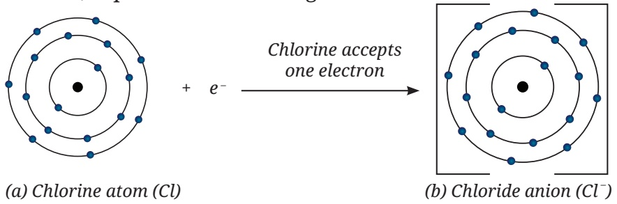
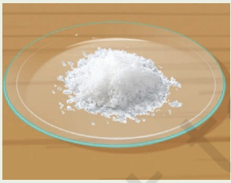
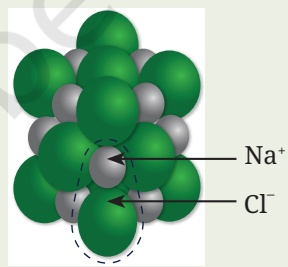
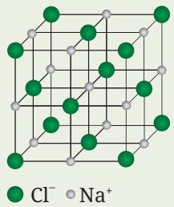

On the other hand, the electronic configuration of a chlorine atom shows that it has seven valence electrons (Fig. 9.12a). It can attain a stable electronic configuration by gaining one electron from another atom. After gaining one extra electron, it acquires a negative charge and is called a chloride **anion**, represented as Cl (Fig. 9.12b).

Fig. 9.12: Formation of a chloride anion

Cations and anions are collectively called ions. Once the sodium and chloride ions are formed, they are held together by the electrostatic force of attraction due to their opposite charges (Fig. 9.13). The electrostatic force of attraction between oppositely charged ions that holds them together is called an **ionic bond**.

$$
\mathrm{Na}_{2}+\mathrm{~_{4}^{\circ}C_{2}^{1}}^{\circ}\xrightarrow{\mathrm{~}}\mathrm{Na}^{+}+\mathrm{~_{2}^{\circ}C_{2}^{1}}^{\circ}\xrightarrow{\mathrm{~}}\mathrm{NaCl}
$$

Fig. 9.13: Formation of sodium chloride by transfer of electron

## Threads of Curiosity

Ionic compounds usually do not remain as single units. They form three-dimensional (3-D) crystals in which ions are arranged in a repeating pattern. For example, in sodium chloride (NaCl), each sodium ion (Na+) is surrounded by six chloride ions (Cl–), and each chloride ion is surrounded by six sodium ions (Fig. 9.14a). These oppositely charged ions are arranged in a regular, repeating 3-D pattern known as a crystal structure (Fig. 9.14b).

(a)

(b)

(c)

Fig. 9.14: Sodium chloride: (a) crystals, (b) crystal structure, and (c) crystal lattice

The crystal structure is represented as a crystal lattice, with ions depicted as points or dots (Fig. 9.14c). It helps to visualise the arrangement of ions in the crystal. You will learn more about the crystal structure in higher grades.

Some elements like sulfur have six electrons in their outer shell and need to gain two electrons to complete their octet. When a sulfur atom gains two electrons, it acquires two units of negative charge and is represented as S2–.