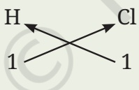
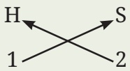
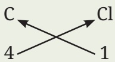

Table 9.1: (b) Some common polyatomic ions

| Name of ion | Formula | Valency |
| --- | --- | --- |
| Hydroxide | OH- | 1 |
| Nitrate | NO3- | 1 |
| Hydrogencarbonate | HCO3- | 1 |
| Carbonate | CO32- | 2 |
| Sulfate | SO42- | 2 |
| Ammonium | NH4+ | 1 |

## 9.5 Writing Chemical Formulae

You have learnt earlier how to write the formulae of compounds by finding the number of electrons which can be shared or transferred. There is yet another way to write the formulae quickly.

## 9.5.1 Writing chemical formulae of covalent compounds

Follow these steps to write the chemical formula of a covalent compound:

(i) Write the symbols of the constituent elements of the compound.

(ii) Write the valencies of these elements (refer to Table 9.1).

(iii) Crossover the valencies of the combining atoms and write them as subscripts after the symbols of elements, as shown below.

<table><tr><td>Examples The formula of hydrogen chloride Symbol of element  Valency The formula of the compound would be HCl. If the valency is one after criss-crossing, it is not written. The formula of carbon tetrachloride</td><td>The formula of hydrogen sulfide Symbol of element  Valency The formula of the compound  $\begin{array} { r } { \mathrm { H } _ { 2 } \mathbb { S } . } \end{array}$  would be</td></tr><tr><td colspan="2">Symbol of element  Valency</td></tr></table>

## 9.5.2 Writing chemical formulae of ionic compounds

Follow the steps given below to write the chemical formula of an ionic compound:

(i) Write the symbol of the cation first, followed by the symbol of the anion.