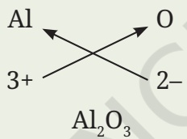
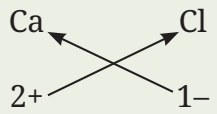
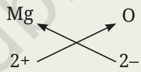
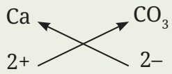
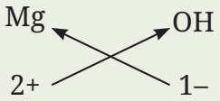

## Note

The charges on the ions are not indicated in the formula of the compound.

(ii) Write the charges under the symbols rather than as superscripts.

(iii) Crossover the charges (only the numbers) as shown below to obtain the formula.

(iv) The chemical formula gives the simplest ratio of the elements in a compound. Therefore, after criss-crossing, the subscripts are divided by a common factor, if any. For example, if we get the subscripts 2 and 4, they are divided by 2 to get 1 and 2, which are then used as subscripts in the formula.

## Examples

The formula of calcium chloride

Symbol

Charge

Formula

CaCl2

Thus, in calcium chloride, there are two chloride ions (Cl–) for each calcium ion $( \mathbb { C } \mathbf { a } ^ { 2 + } )$ The positive and negative charges must balance each <u>other, and the overall structure must be neutral.</u>

## The formula of aluminium oxide —

The formula for magnesium oxide

Symbol

Charge

Formula

Symbol

Charge

Here, the valencies of the two elements are the same. We arrive at the formula $\mathrm { M g _ { 2 } O _ { 2 } }$ but it is simply written as MgO.

This method can also be used to write formulae of compounds of metals with other polyatomic ions, such as calcium carbonate.

For magnesium hydroxide, we write the symbol of the cation $( \mathrm { M g ^ { 2 + } } )$ first, followed by the symbol of the anion (OH–). Then, their charges (only the numbers) are criss-crossed to get the formula.

## Examples

The formula for calcium carbonate

The formula of magnesium

Symbol

Charge

hydroxide

Symbol

Formula

CaCO3

Charge

Here, the valencies of the two ions are the same. The formula $\mathrm{Ca}_{2}(\mathrm{CO}_{3})_{2}$ is simply written as $\mathsf { C a C O } _ { 3 ^ { \prime } }$ as explained above.

Formula

$$
\mathrm{Mg(OH)}_{2}
$$