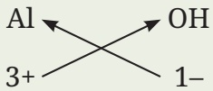
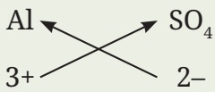

Thus, in magnesium hydroxide, there are two hydroxide ions (OH–) for each magnesium ion $( \mathrm { M g ^ { 2 + } } )$ . We use brackets ( ) when we have two or more polyatomic ions of the same type in a formula. In the example of aluminium hydroxide given below, the bracket around OH with a subscript 3 indicates that there are three hydroxide (OH–) ions bound to one aluminium ion. Brackets are not required when only one polyatomic anion is present.

## Examples

The formula of aluminium

hydroxide —

Symbol

Charge

The formula of aluminium

sulfate —

Symbol

$$
Al ( OH )_{_3}
$$

Formula

Charge

Formula

$$
\mathrm{Al}_{_2}(\mathrm{SO}_{_4})_{_3}
$$

Note: Formula of aluminium

hydroxide is $\mathrm { A l ( O H ) } _ { 3 } ,$ not $\mathrm { A l O H } _ { 3 ^ { \circ } }$

## Pause and Ponder

16. Name the following:

(i) $\mathrm { C O } _ { 2 }$

(ii) $\mathrm { N O } _ { 2 }$

(iii) $\mathrm { S F _ { 6 } }$

(iv) $\mathrm { P C l } _ { 3 }$

17. Write the formula for the following:

(i) Sodium hydrogencarbonate

(ii) Sulfur dioxide

(iii) Ferric chloride

(iv) Cuprous oxide

18. Write the formulae for the compounds formed from the following pairs of ions:

(i) $\mathrm { F e ^ { 3 + } }$ and OH‒ (ii) K+ and $\mathrm { C O _ { 3 } ^ { 2 - } }$

## 9.6 Properties of the Ionic and the Covalent Compounds

**Activity 9.4: Let us experiment**

1. Collect the samples of some compounds, such as camphor, sodium chloride, copper sulfate, sugar and naphthalene.

**(A) Solubility in (i) water, (ii) kerosene, and (iii) petrol**

2. Try dissolving each sample separately in the water, kerosene and petrol.

3. Record your observations in Table 9.2.

**(B) Electrical conductivity in the water**

**Safety first**: Do not touch the electrodes when they are connected to the battery but use a low-voltage battery to avoid the risk of shock. Petrol and kerosene are flammable liquids, so be careful while working with them.