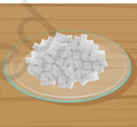
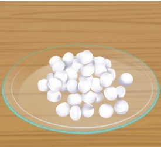

Ionic compounds generally have high melting and boiling points due to strong inter-ionic attractions, whereas covalent compounds usually have low melting and boiling points.

## Pause and Ponder

19. What type of chemical bond is present in a solid compound that does not conduct electricity in the solid state but conducts electricity when dissolved in water?

20. Metal M, with two electrons in its valence shell (M shell), reacts with oxygen to form a compound that is slightly soluble in water. Predict its:

(i) formula

(ii) type of bond

(iii) electrical conductivity of its aqueous solution.

## 9.7 Molecular Mass of Covalent Compounds

Since you know the formulae of the covalent compounds, you can find the masses of their molecules by simply adding up the masses of the atoms present in them.

**Example 9.4**

Molecular mass of water $( \mathrm { H } _ { 2 } \mathrm { O } )$

Atomic mass — H = 1 u; O = 16 u

(a) Camphor

Molecular mass of $\mathrm{H_2O} = (1\mathrm{~u} \times 2) + (16\mathrm{~u} \times 1) = 18\mathrm{~u}$

## Example 9.5

Molecular mass of carbon dioxide (CO )

Atomic mass — C = 12 u; O = 16 u

Molecular Mass of $\mathrm{CO}_{2}=(12\mathrm{~u}\times1)+(16\mathrm{~u}\times2)=44\mathrm{~u}$

You have learnt in section 9.4.2 that in ionic compounds, the ions form 3-D crystals, i.e., ionic compounds do not form molecules.

(b) Naphthalene Fig. 9.17: Covalent compounds

## Pause and Ponder

21. Find the molecular mass of nitric acid (HNO ). Atomic mass — H = 1 u; $N = 14   u ; \; O = 16   u .$

22. Find the molecular mass of methane (CH ). Atomic mass $C = 12   u ;  H = 1   u .$

## 9.8 Formula Unit Mass of Ionic Compounds

In ionic compounds, the collection of the simplest whole number ratio of ions is termed as a **formula unit**. The mass of a formula unit is called the **formula unit mass**.

## Example 9.6

Formula unit mass of sodium oxide $( \mathrm { N a } _ { 2 } \mathrm { O } )$

Atomic mass — Na = 23 u; O = 16 u

Formula unit mass of $\mathrm{Na}_{2}\mathrm{O}=(23\mathrm{~u}\times2)+(16\mathrm{~u}\times1)=62\mathrm{~u}$